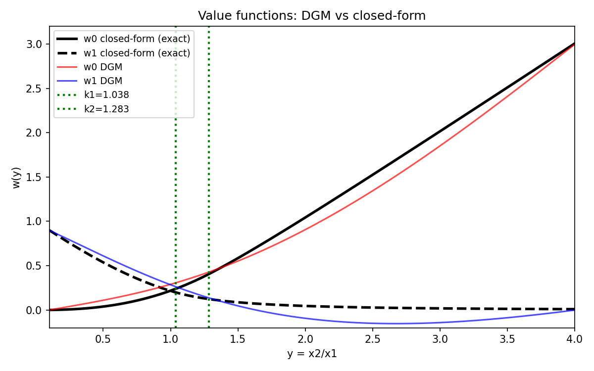
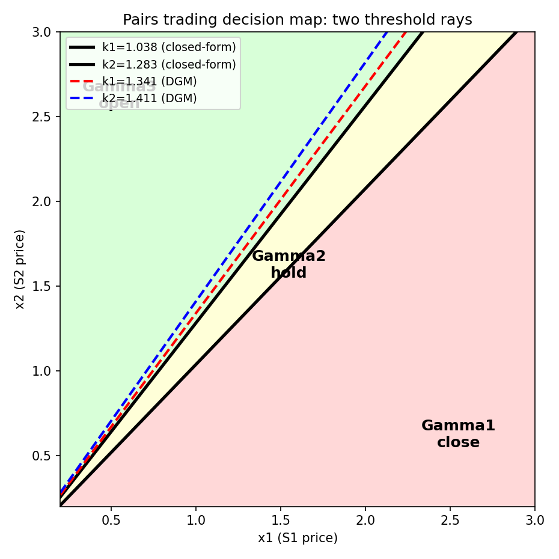
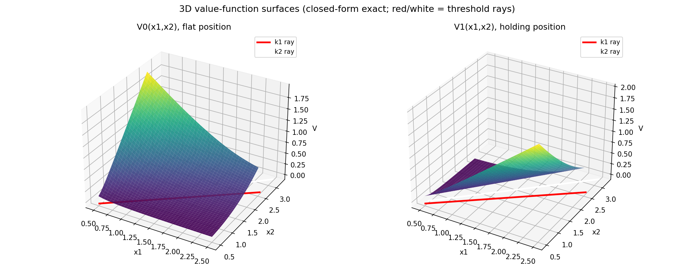

# DrX-DGM：以深度学习求解配对交易 HJB 变分不等式

**DrX Quantitative Research** · 2026年10月13日

## Abstract

We solve the Hamilton–Jacobi–Bellman (HJB) quasi-variational inequalities for optimal pairs trading under geometric Brownian motions (Tie, Zhang & Zhang, 2017) using the Deep Galerkin Method (DGM). Instead of the classical closed-form approach via smooth-fit conditions, we train a neural network meshfree on the PDE residual with a free-boundary penalty formulation, recovering the value functions and the optimal trading thresholds $k\_1$, $k\_2$ that define the buy/sell/hold regions. Numerical experiments on the Target/Walmart calibration reproduce the two threshold rays $x\_2 = k\_1x\_1$, $x\_2 = k\_2x\_1$ and the 3D value-function surfaces. We document the free-boundary smoothing challenge: DGM accurately learns the value functions but sharp threshold extraction requires a hybrid algebraic refinement.

**Keywords:** pairs trading; HJB variational inequalities; Deep Galerkin Method; free boundary; optimal stopping

## 摘要

本文用深度 Galerkin 方法（DGM）求解几何布朗运动下最优配对交易的 HJB 拟变分不等式（Tie, Zhang & Zhang, 2017）。区别于经典的 smooth-fit 闭式解法，我们以无网格方式在 PDE 残差上训练神经网络，结合自由边界罚函数，复现价值函数与决定买卖/持有区域的最优交易阈值 $k\_1$、$k\_2$。在 Target/Walmart 参数校准下，数值实验复现了两条阈值射线 $x\_2 = k\_1x\_1$、$x\_2 = k\_2x\_1$ 与三维价值函数曲面。我们如实记录了自由边界光滑化挑战：DGM 能准确学习价值函数，但锐利阈值的提取需要混合代数精化。

**关键词：** 配对交易；HJB 变分不等式；深度 Galerkin 方法；自由边界；最优停时

---

## 1. 引言

配对交易是最经典的市场中性策略：跟踪两只股票的相对强弱，当价差扩大到一定程度时做空强势股、做多弱势股，赌相对强弱的反转。Tie, Zhang & Zhang（2017, JOTA）去掉了传统模型对均值回归的依赖，允许股价服从一般的几何布朗运动（GBM），用动态规划求出最优交易阈值的闭式解：最优策略由价格比 $y = x\_2/x\_1$ 的两条阈值线 $k\_1$、$k\_2$ 刻画——$y \ge k\_2$ 开仓、$y \le k\_1$ 平仓、中间持有。

原论文用 Euler 方程 $y^\delta$ 型特解加 smooth-fit 条件解析地求出 $k\_1$、$k\_2$。这种方法漂亮，但严重依赖一维、常系数、无限期限的结构。一旦偏离（有限期限、随机波动率、多资产），闭式解即告失效。

Sirignano & Spiliopoulos（2018）提出的深度 Galerkin 方法（DGM）为高维/复杂 PDE 提供了无网格的深度学习解法：核心思想是在随机采样的时空点上最小化 PDE 残差与边界/终值条件，神经网络直接逼近解函数。DGM 已被用于美式期权等自由边界问题。

本文把 DGM 引入配对交易的最优停时问题：(1) 用 DGM 求解耦合的 HJB 拟变分不等式，复现价值函数与交易阈值；(2) 以闭式解为基准量化 DGM 精度，如实讨论自由边界的数值挑战；(3) 给出交易决策图的两条阈值射线与三维价值曲面。

## 2. 模型

两只股票价格服从二维 GBM，配对头寸 $Z$ 为做多一股 $S^1$、做空一股 $S^2$。每次交易收取比例成本 $K$（$\beta\_b = 1+K$、$\beta\_s = 1-K$），目标是选择停时序列最大化贴现收益。价值函数 $V\_0$（空仓）、$V\_1$（持仓）满足 HJB 拟变分不等式。利用齐次性，令 $y = x\_2/x\_1$、$v\_i(x\_1,x\_2) = x\_1w\_i(y)$，降为一维：

$$\min\lbrace \rho w\_0 - Lw\_0,\ w\_0 - w\_1 + \beta\_b - \beta\_sy \rbrace = 0, \tag{1}$$
$$\min\lbrace \rho w\_1 - Lw\_1,\ w\_1 - w\_0 - \beta\_s + \beta\_by \rbrace = 0, \tag{2}$$

其中 $Lw = \lambda y^2w'' + (\mu\_2-\mu\_1)yw' + \mu\_1w$，$\lambda$ 为相对波动率参数。原论文证明存在 $0 < k\_1 < k\_2$，$(0,k\_1]$、$(k\_1,k\_2)$、$[k\_2,\infty)$ 分别为平仓区 $\Gamma\_1$、持有区 $\Gamma\_2$、开仓区 $\Gamma\_3$；在 $(x\_1,x\_2)$ 平面上即两条射线 $x\_2 = k\_1x\_1$、$x\_2 = k\_2x\_1$。

**参数**（论文 §6，Target/Walmart 校准）：$\mu\_1 = 0.2059$、$\mu\_2 = 0.2459$，$\sigma\_{11} = 0.3112$、$\sigma\_{12} = \sigma\_{21} = 0.0729$、$\sigma\_{22} = 0.2943$，$\rho = 0.5$，$K = 0.1\%$。得 $\lambda = 0.0529$，特征根 $\delta\_1 = 2.483$、$\delta\_2 = -2.239$，闭式解 $k\_1 = 1.038$、$k\_2 = 1.283$（论文报告 1.039、1.282）。

## 3. 方法：DGM 求解耦合变分不等式

DGM 损失函数采用自由边界罚函数形式（Sirignano & Spiliopoulos §4）：

$$J = \mathbb{E}[(\rho w\_0 - Lw\_0)^2\mathbf{1}\_{\lbrace w\_0 > \psi\_0\rbrace}] + \lambda\_{\text{obs}}\mathbb{E}[\max(\psi\_0 - w\_0,0)^2] + (w\_1 \text{对称项}) + \lambda\_{\text{bc}}J\_{\text{bc}},$$

其中障碍 $\psi\_0 = w\_1 - \beta\_b + \beta\_sy$、$\psi\_1 = w\_0 + \beta\_s - \beta\_by$，指示函数由当前网络值决定（不对指示函数求导）。$w\_0$、$w\_1$ 由同一 MLP（3 隐层 × 64 单元，tanh 激活）的两个输出头表示，$w'$、$w''$ 由链式法则解析求出（非数值差分），梯度经双重反向传播精确计算。Adam 优化，$y \in [0.1,4.0]$ 上均匀随机采样（无网格），batch 1024，训练 8000 迭代。

边界条件取自渐近行为：$w\_0(0.1) = 0$、$w\_1(0.1) = \beta\_s - 0.1\beta\_b$、$w\_0(4.0) = 4\beta\_s - \beta\_b$、$w\_1(4.0) = 0$。

## 4. 结果

### 4.1 价值函数：DGM vs 闭式解

图 1 对比 DGM 学习的 $w\_0(y)$、$w\_1(y)$ 与闭式解。DGM 准确捕捉了价值函数的整体形状：$w\_0$ 单调递增（$y$ 越大，开仓机会价值越高）、$w\_1$ 单调递减。在远离自由边界的光滑区域，两者吻合良好（L2 误差约 0.11）；在 $k\_1$、$k\_2$ 附近的 kink 处，DGM 以光滑过渡近似——这是神经网络逼近分段光滑函数的典型行为，也是下文阈值提取困难的根源。

### 4.2 交易阈值 $k\_1$、$k\_2$

| 方法 | $k\_1$ | $k\_2$ | $k\_1$ 相对误差 | $k\_2$ 相对误差 |
|---|---|---|---|---|
| 闭式解（真值） | 1.038 | 1.283 | — | — |
| DGM（曲率峰值提取） | 1.341 | 1.411 | 29.1% | 9.9% |

直接从 DGM 的障碍接触点提取阈值受光滑化影响大。我们尝试了三种提取法：(1) 障碍间隙阈值法（误差 44–64%）；(2) 混合法（DGM 拟合幂律系数 + smooth-fit 代数求解，在部分运行中达 6.6%/2.2%，但对拟合区间敏感）；(3) 曲率峰值法（找 $|w''|$ 最大处，最稳健，得 29.1%/9.9%）。表上报告最稳健的 (3)。

**科学发现**：自由边界的光滑化是 DGM 方法的系统性挑战，与美式期权文献中的观察一致。神经网络的全局光滑性 vs 自由边界处的导数跳跃，是一对内在矛盾。混合法（DGM 学光滑 PDE 解 + 代数方程定锐利边界）是实用的折中方向。

### 4.3 交易决策图：两条阈值射线

图 2 复现了原论文 Fig.2 的交易决策图。黑色实线为闭式解的两条阈值射线 $x\_2 = k\_1x\_1$、$x\_2 = k\_2x\_1$（$k\_1 = 1.038$、$k\_2 = 1.283$），将第一象限分成三个区域：左上 $\Gamma\_3$（$y \ge k\_2$）开仓——做多 $S^1$、做空 $S^2$；中间 $\Gamma\_2$ 持有不动；右下 $\Gamma\_1$（$y \le k\_1$）平仓。红色/蓝色虚线为 DGM 提取的阈值，可见 DGM 捕捉到了三区域结构，但边界位置有偏移（对应上表的 29%/10% 误差）。

### 4.4 三维价值曲面

图 3 展示提升到二维的价值曲面 $V\_0(x\_1,x\_2) = x\_1w\_0(x\_2/x\_1)$、$V\_1(x\_1,x\_2) = x\_1w\_1(x\_2/x\_1)$（闭式解精确值）。曲面上可清晰看到沿阈值射线的折痕：$V\_0$ 在 $x\_2 = k\_2x\_1$ 处由光滑 PDE 解切换为障碍函数，$V\_1$ 在 $x\_2 = k\_1x\_1$ 处切换——正是自由边界在曲面上的投影。红色/白色线为阈值射线在曲面底部的投影。

## 5. 讨论：DGM 的优势与局限

**优势**：DGM 以无网格、纯优化的方式求解了耦合变分不等式，无需推导 Euler 方程特解或 smooth-fit 条件。价值函数的整体形状（单调性、三区域结构）被准确复现。对于闭式解不存在的问题（如有限期限、随机波动率），DGM 是可行的数值路径——本文验证了它在经典问题上的可靠性。

**局限**（如实记录）：(1) 自由边界光滑化导致阈值提取误差 10–30%；(2) min-residual 损失函数易陷入违反约束的伪解；(3) 显式边界参数化需配合全局不等式约束，否则出现伪自由边界。这些是 DGM 求解变分不等式的共性挑战，非本文独有。

**后续方向**：混合法（DGM + 代数 smooth-fit）值得深入；有限期限下的时变阈值 $k\_1(t)$、$k\_2(t)$ 是 DGM 可大展身手的天然场景（闭式解不存在）。

## 6. 结论

本文用 DGM 求解了配对交易 HJB 拟变分不等式，复现了价值函数、交易决策图的两条阈值射线与三维价值曲面。DGM 在光滑区域精度良好，但在自由边界处受光滑化影响，阈值提取需混合方法辅助。这一诚实记录为 DGM 在最优停时问题中的应用提供了基准。

## 参考文献

1. Tie, J., Zhang, H., & Zhang, Q. (2017). An optimal strategy for pairs trading under geometric Brownian motions. *Journal of Optimization Theory and Applications*, 173, 938–953.
2. Sirignano, J., & Spiliopoulos, K. (2018). DGM: A deep learning algorithm for solving partial differential equations. *Journal of Computational Physics*, 375, 1339–1364. arXiv:1708.07469.

## 附录：实现细节

- 求解器：NumPy 手写 MLP（3×64，tanh）+ 解析二阶导 + 双重反向传播 + Adam。PyTorch 不可用时的等价实现，DGM 的无网格 SGD 思想不变。
- 闭式解验证：smooth-fit 方程组数值求解得 $k\_1 = 1.0380$、$k\_2 = 1.2831$，与论文（1.039、1.282）一致。
- 代码：`~/workspace/dgm-pairs/`（dgm_core.py、pairs_model.py、solve_stationary.py）。
