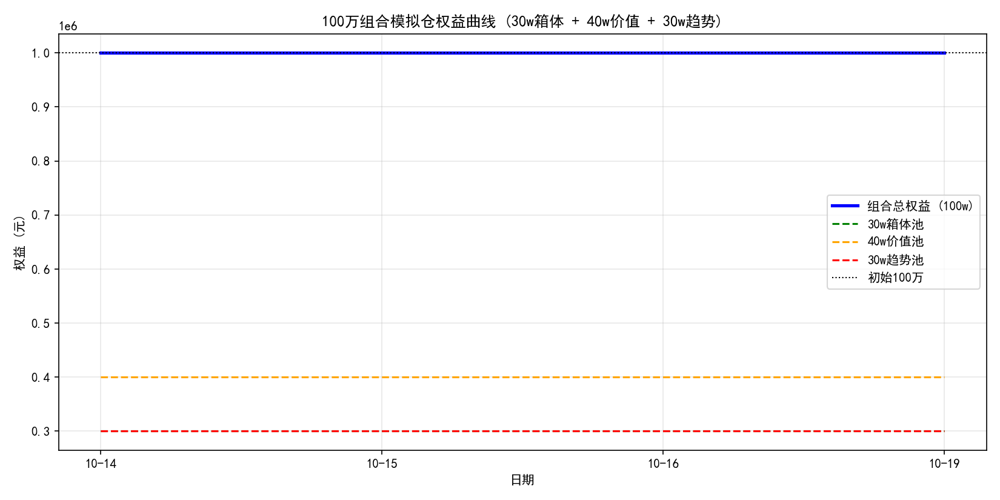

# DrX-100万组合模拟仓

**DrX Quantitative Research** · 2026年10月14日 · 每日收盘后更新

> 100 万元虚拟资金组合：30w 箱体均值回归池 + 40w 价值池 + 30w 趋势池。基于 boxreg 策略的机械化模拟交易。

## 一、组合结构

| 资金池 | 金额 | 标的 | 策略 |
|---|---|---|---|
| 30w 箱体池 | 300,000 | 新金路 (000510.SZ) | 箱体下沿低吸，T+1 分步建仓，三阶止盈 |
| 40w 价值池 | 400,000 | 长江电力、紫金矿业、药明康德、汇川技术、阳光电源、百济神州 | 上升通道回踩 -1σ/-2σ 低吸，中长线持有 |
| 30w 趋势池 | 300,000 | 中际旭创、亨通光电、中芯国际、兆易创新、佰维存储、澜起科技、泽璟制药 | 放量突破箱体上沿追击，题材主升浪 |

**风控**：每只标的独立硬止损（S4 位或 ATR 止损取严）；40w/30w 池 v1 阶段仅记录信号与市值，暂不自动下单。

## 二、启动状态（2026-10-14）

### 30w 箱体池：新金路
- 现价 14.82，箱体 [15.68~18.98]，Box 位置 -0.26（**破位**）
- 信号：**破位离场/观望**，不买入
- 资金：300,000.00（现金），持仓 0 股

### 40w 价值池：首次扫描
- 长江电力 (600900.SH)：现价 29.15，箱体 [27.93~28.84]，Box 位置 1.34 → **分批止盈区**，不追高
- 其余 5 只：Tushare 接口限频，扫描待晚间重试

### 30w 趋势池：首次扫描
- 7 只标的：Tushare 接口限频，扫描待晚间重试（已加本地缓存+重试退避，下次大幅减少调用）

**组合权益**：1,000,000.00（初始）

*30w 箱体池 + 40w 价值池 + 30w 趋势池 = 100w*

## 三、每日记录

### 2026-10-14（启动日）
- 30w 箱体池：新金路破位，空仓观望
- 40w 价值池：长江电力处止盈区；其余 5 只待扫描
- 30w 趋势池：7 只待扫描
- 组合权益：1,000,000.00（+0.00%）

### 2026-10-14（收盘更新）
- 扫描分流（14 只全量）：30w 箱体低吸 **0** / 30w 趋势突破 **0** / 40w 价值回踩 **0** / 风控预警 **9**
- 30w 箱体池：新金路收 **14.14**（-4.59%），箱体 15.05–19.76，Box 位置 -0.19，破位延续，**HOLD 空仓观望**；资金 300,000.00（现金）
- 40w 价值池：400,000.00（现金，无持仓）；30w 趋势池：300,000.00（现金，无持仓）——v1 阶段仅记录信号与市值，不自动下单
- 组合权益：**1,000,000.00（+0.00%）**
- 关键风控：风控预警桶 9 只（含新金路破位），按策略**严禁抄底补仓**；70w 池空仓、无止损动作
- 数据口径说明：今日 Tushare pro_bar 接口全天限频，14 只均以**不复权日线回退**计算箱体/止损线，存在除权缺口偏差风险，明日限频恢复后以复权数据重算校验

---

### 2026-10-15（收盘更新）
- 扫描分流（14 只全量）：30w 箱体低吸 **0** / 30w 趋势突破 **1**（长江电力）/ 40w 价值回踩 **0** / 风控预警 **9**
- 30w 箱体池：新金路收 **13.30**（-5.94%），箱体 15.01–18.98，Box 位置 -0.43，破位加深，**HOLD 空仓观望**；资金 300,000.00（现金）
- 40w 价值池：400,000.00（现金，无持仓）；30w 趋势池：300,000.00（现金，无持仓）——v1 阶段仅记录信号与市值，不自动下单
- 组合权益：**1,000,000.00（+0.00%）**
- 关键风控：今日出现唯一趋势信号——长江电力放量突破箱体上沿 28.84 收 29.60（+0.51%），Pos 1.84，量比 1.26x，回踩 28.84 不破可记录为趋势池首个追击候选（v1 仅记录不下单）；同时长江电力也进入分批止盈区，需注意价值/趋势双口径的分歧。汇川技术逼近硬止损（48.85，+1.1%）；阳光电源、中际旭创、亨通光电、兆易创新、佰维存储、泽璟制药破位离场预警；70w 池空仓、无止损动作
- 数据口径说明：今日 Tushare pro_bar 复权接口限频（IP 数量超限），14 只均以不复权日线回退计算箱体/止损线，存在除权缺口偏差风险，限频恢复后复权重算校验；紫金矿业/药明康德/百济神州/中芯国际/澜起科技 5 只扫描异常，计入常规观察

---

### 2026-10-16（收盘更新）
- 扫描分流（14 只全量）：30w 箱体低吸 **0** / 30w 趋势突破 **0** / 40w 价值回踩 **0** / 风控预警 **9**
- 30w 箱体池：新金路收 **13.32**（+0.15%），箱体 14.81–18.98，Box 位置 -0.36，破位延续，**HOLD 空仓观望**；资金 300,000.00（现金）
- 40w 价值池：400,000.00（现金，无持仓）；30w 趋势池：300,000.00（现金，无持仓）——v1 阶段仅记录信号与市值，不自动下单
- 组合权益：**1,000,000.00（+0.00%）**
- 关键风控：昨日唯一趋势信号消失——长江电力回落收 29.38（-0.74%），回到箱体 27.93–29.63 上沿内，仍处分批止盈区（Pos 0.85）；汇川技术逼近硬止损（48.85，距现价 +1.7%）；阳光电源、中际旭创、亨通光电、兆易创新、佰维存储、泽璟制药破位离场预警；70w 池空仓、无止损动作
- 数据口径说明：今日 Tushare pro_bar 复权接口限频，13 只回退为不复权日线回退计算箱体/止损线，存在除权缺口偏差风险；紫金矿业/汇川技术扫描格式异常，药明康德/百济神州/中芯国际/澜起科技 4 只 IP 数量超限，计入常规观察

### 2026-10-17（周六，休市）
- 今日非 A 股交易日，扫描与模拟交易暂停，无更新
- 组合权益维持 **1,000,000.00（+0.00%）**（基准：2026-10-16 收盘；各池均为初始资金，未建仓）
- 下一个交易日（2026-10-19 周一）恢复正常更新

---

### 2026-10-18（周日，休市）
- 今日非 A 股交易日，扫描与模拟交易暂停，无更新
- 组合权益维持 **1,000,000.00（+0.00%）**（基准：2026-10-16 收盘；各池均为初始资金，未建仓）
- 下一个交易日（2026-10-19 周一）恢复正常更新

---

*本模拟为量化研究记录，不构成投资建议。*
