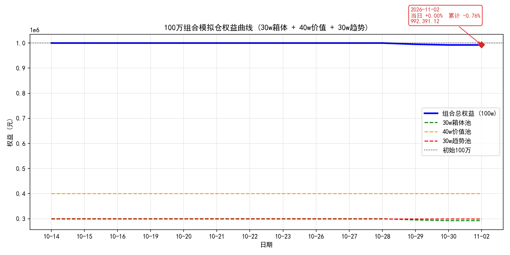

# DrX-100万组合模拟仓

**DrX Quantitative Research** · 2026年10月14日 · 每日收盘后更新

> 100 万元虚拟资金组合：30w 箱体均值回归池 + 40w 价值池 + 30w 趋势池。基于 boxreg 策略的机械化模拟交易。

## 一、组合结构

| 资金池 | 金额 | 标的 | 策略 |
|---|---|---|---|
| 30w 箱体池 | 300,000 | 新金路 (000510.SZ) | 箱体下沿低吸，T+1 分步建仓，三阶止盈 |
| 40w 价值池 | 400,000 | 长江电力、紫金矿业、药明康德、汇川技术、阳光电源、百济神州 | 上升通道回踩 -1σ/-2σ 低吸，中长线持有 |
| 30w 趋势池 | 300,000 | 中际旭创、亨通光电、中芯国际、兆易创新、佰维存储、澜起科技、泽璟制药 | 放量突破箱体上沿追击，题材主升浪 |

**风控**：每只标的独立硬止损（S4 位或 ATR 止损取严）；40w/30w 池 v1 阶段仅记录信号与市值，暂不自动下单。

## 二、当前状态（截至 2026-11-09 收盘）

组合自 2026-10-14 启动以来共 19 个交易日记录：新金路 -1.88% 收 9.40，30w 池 T0 试探仓浮亏扩大至 -2.20%，70w 两池仍空仓。11-09 扫描分流：箱体低吸 0 / 趋势突破 0 / 价值回踩 0 / 风控预警 10——无新增突破或回踩信号，阳光电源 -5.03% 跌破止损线 78.00，11-05 的趋势突破信号失效；药明康德、百济神州、兆易创新 3 只 IP 超限无数据，相关状态暂挂起。

### 30w 箱体池：新金路
- 资金：293,401.35（现金 239,821.35，持仓 5,700 股）；本池累计收益 **-6,598.65（-2.20%）**
- 已完成交易：10-29 以 10.61 买入 8,400 股（T0 试探仓）；10-30 盘中触及硬止损 9.72、按预设止损价卖出清仓，已实现盈亏 -7,608.88；11-03 以 9.22 买入 5,700 股（第二轮 T0 试探仓）
- 最新 boxreg（11-09 收盘重算）：收 9.40，箱体 9.38–13.85，Box 位置 0.00，MA20 11.44 / MA60 15.21
- 当前信号：**持有并挂三阶止盈单**——今日无成交：盘中最高 9.95 未触及 TP1 14.55，盘中最低 9.40 高于锁定硬止损 8.38，未触发盘中止损，持仓保留；三阶止盈单 TP1 14.55（2,800 股）/ TP2 16.64（3,800 股）/ TP3 18.49（2,900 股），锁定硬止损 8.38 不变。按锁定入场箱体重算 Box 位置 0.02 仍处买入区，但已持仓 5,700 股且挂有止盈单，不新开仓

### 40w 价值池
- 资金：400,000.00（全现金），持仓 0；本池累计收益 **0.00（0.00%）**（v1 阶段仅记录信号与市值，不自动下单）
- 11-09 扫描：回踩低吸信号 0。长江电力 -0.27% 收 29.83，Pos 0.83 处分批止盈区，挂单 TP2@29.80（40%）/ TP3@29.99（30%）；汇川技术 +1.57% 收 57.55，Pos 0.97 处分批止盈区，挂单 TP2@56.00（40%）/ TP3@56.21（30%）；阳光电源 -5.03% 收 77.85，跌破止损线 78.00（-0.20%），破位离场预警；紫金矿业 +0.46% 收 28.41，Pos 0.44，距止损线 26.55 尚有 +6.50% 缓冲
- 重点盯防：药明康德、百济神州今日 IP 超限无数据，昨日分批止盈区状态暂挂起；阳光电源跌破止损线，11-05 的趋势突破信号失效

### 30w 趋势池
- 资金：300,000.00（全现金），持仓 0；本池累计收益 **0.00（0.00%）**（v1 阶段仅记录信号与市值，不自动下单）
- 11-09 扫描：右侧突破信号 0。阳光电源 -5.03% 收 77.85，跌破箱体上沿 81.39 与止损线 78.00，11-05 的放量突破信号失效，转为破位离场预警；趋势池 7 只中 5 只今日仍低于止损线、破位未改：中际旭创 +0.90% 收 452.03（低于止损线 690.16，-52.70%）、亨通光电 +3.20% 收 42.21（-8.00%）、佰维存储 -0.47% 收 125.41（-31.00%）、澜起科技 -0.29% 收 149.67（-18.70%）、泽璟制药 -0.65% 收 90.21（-7.60%），单日涨跌不等于企稳，不抄底、不追反弹；兆易创新今日 IP 超限无数据，11-06 临界状态（距 S4 仅 0.54%）暂挂起；中芯国际 -1.70% 收 109.02，Pos 1.12 处分批止盈区，挂单 TP2@106.89（40%）/ TP3@107.79（30%）

**组合权益**：993,401.35（累计 **-0.66%**；亏损全部来自 30w 池，70w 两池空仓无损）。最近一日（11-09）盈亏 -0.10%（-1,026.00，全部来自 30w 池 T0 持仓浮亏扩大）。下方曲线每日收盘后更新，逐日明细见「三、每日记录」。

*30w 箱体池 + 40w 价值池 + 30w 趋势池 = 100w*

### 互动权益曲线（K线式）

<iframe src="portfolio100w_equity_interactive.html" width="100%" height="740" style="border:1px solid #ddd;border-radius:8px" loading="lazy" title="100万组合互动权益曲线"></iframe>

互动版（Plotly，每日 17:10 随权益数据自动重绘）：上图为组合总权益 K 线（开=前一日权益、收=当日权益，红涨绿跌）叠加三池折线，可用底部滑杆缩放（范围限定在模拟期内），时间轴按交易日连续排布、不留周末空缺，十字光标查看任意一日数据；下图为当日盈亏 % 柱状图与累计收益率折线。**曲线最后一个点上方标注最近一日的盈亏比例**、当日盈亏额与累计收益率，随每日更新自动刷新。

## 三、每日记录

### 2026-10-14（启动日）
- 30w 箱体池：新金路破位，空仓观望
- 40w 价值池：长江电力处止盈区；其余 5 只待扫描
- 30w 趋势池：7 只待扫描
- 组合权益：1,000,000.00（+0.00%）

### 2026-10-14（收盘更新）
- 扫描分流（14 只全量）：30w 箱体低吸 **0** / 30w 趋势突破 **0** / 40w 价值回踩 **0** / 风控预警 **9**
- 30w 箱体池：新金路收 **14.14**（-4.59%），箱体 15.05–19.76，Box 位置 -0.19，破位延续，**HOLD 空仓观望**；资金 300,000.00（现金）
- 40w 价值池：400,000.00（现金，无持仓）；30w 趋势池：300,000.00（现金，无持仓）——v1 阶段仅记录信号与市值，不自动下单
- 组合权益：**1,000,000.00（+0.00%）**
- 关键风控：风控预警桶 9 只（含新金路破位），按策略**严禁抄底补仓**；70w 池空仓、无止损动作
- 数据口径说明：今日 Tushare pro_bar 接口全天限频，14 只均以**不复权日线回退**计算箱体/止损线，存在除权缺口偏差风险，明日限频恢复后以复权数据重算校验

---

### 2026-10-15（收盘更新）
- 扫描分流（14 只全量）：30w 箱体低吸 **0** / 30w 趋势突破 **1**（长江电力）/ 40w 价值回踩 **0** / 风控预警 **9**
- 30w 箱体池：新金路收 **13.30**（-5.94%），箱体 15.01–18.98，Box 位置 -0.43，破位加深，**HOLD 空仓观望**；资金 300,000.00（现金）
- 40w 价值池：400,000.00（现金，无持仓）；30w 趋势池：300,000.00（现金，无持仓）——v1 阶段仅记录信号与市值，不自动下单
- 组合权益：**1,000,000.00（+0.00%）**
- 关键风控：今日出现唯一趋势信号——长江电力放量突破箱体上沿 28.84 收 29.60（+0.51%），Pos 1.84，量比 1.26x，回踩 28.84 不破可记录为趋势池首个追击候选（v1 仅记录不下单）；同时长江电力也进入分批止盈区，需注意价值/趋势双口径的分歧。汇川技术逼近硬止损（48.85，+1.1%）；阳光电源、中际旭创、亨通光电、兆易创新、佰维存储、泽璟制药破位离场预警；70w 池空仓、无止损动作
- 数据口径说明：今日 Tushare pro_bar 复权接口限频（IP 数量超限），14 只均以不复权日线回退计算箱体/止损线，存在除权缺口偏差风险，限频恢复后复权重算校验；紫金矿业/药明康德/百济神州/中芯国际/澜起科技 5 只扫描异常，计入常规观察

---

### 2026-10-16（收盘更新）
- 扫描分流（14 只全量）：30w 箱体低吸 **0** / 30w 趋势突破 **0** / 40w 价值回踩 **0** / 风控预警 **9**
- 30w 箱体池：新金路收 **13.32**（+0.15%），箱体 14.81–18.98，Box 位置 -0.36，破位延续，**HOLD 空仓观望**；资金 300,000.00（现金）
- 40w 价值池：400,000.00（现金，无持仓）；30w 趋势池：300,000.00（现金，无持仓）——v1 阶段仅记录信号与市值，不自动下单
- 组合权益：**1,000,000.00（+0.00%）**
- 关键风控：昨日唯一趋势信号消失——长江电力回落收 29.38（-0.74%），回到箱体 27.93–29.63 上沿内，仍处分批止盈区（Pos 0.85）；汇川技术逼近硬止损（48.85，距现价 +1.7%）；阳光电源、中际旭创、亨通光电、兆易创新、佰维存储、泽璟制药破位离场预警；70w 池空仓、无止损动作
- 数据口径说明：今日 Tushare pro_bar 复权接口限频，13 只回退为不复权日线回退计算箱体/止损线，存在除权缺口偏差风险；紫金矿业/汇川技术扫描格式异常，药明康德/百济神州/中芯国际/澜起科技 4 只 IP 数量超限，计入常规观察

### 2026-10-17（周六，休市）
- 今日非 A 股交易日，扫描与模拟交易暂停，无更新
- 组合权益维持 **1,000,000.00（+0.00%）**（基准：2026-10-16 收盘；各池均为初始资金，未建仓）
- 下一个交易日（2026-10-19 周一）恢复正常更新

---

### 2026-10-18（周日，休市）
- 今日非 A 股交易日，扫描与模拟交易暂停，无更新
- 组合权益维持 **1,000,000.00（+0.00%）**（基准：2026-10-16 收盘；各池均为初始资金，未建仓）
- 下一个交易日（2026-10-19 周一）恢复正常更新

---

---

### 2026-10-19（收盘更新）
- 扫描分流（14 只全量）：30w 箱体低吸 **0** / 30w 趋势突破 **0** / 40w 价值回踩 **0** / 风控预警 **6**
- 30w 箱体池：新金路收 **13.12**（-1.50%），箱体 14.54–18.98，Box 位置 -0.32，破位延续，**HOLD 空仓观望**；资金 300,000.00（现金）
- 40w 价值池：400,000.00（现金，无持仓）；30w 趋势池：300,000.00（现金，无持仓）——v1 阶段仅记录信号与市值，不自动下单
- 组合权益：**1,000,000.00（+0.00%）**
- 关键风控：长江电力站上箱体上沿附近（收 29.54，+0.54%，Pos 0.95，箱体 27.93–29.63），进入分批止盈区挂单 TP2/TP3；新金路、阳光电源、中际旭创、兆易创新、佰维存储破位离场预警（均跌破止损线）；泽璟制药 +5.52% 反弹收 102.00，重回止损线上方，降级为常规观察；70w 池空仓、无止损动作
- 数据口径说明：今日 Tushare pro_bar 复权接口限频（IP 数量超限），13 只回退为不复权日线回退计算箱体/止损线，存在除权缺口偏差风险；药明康德/百济神州/中芯国际/澜起科技 4 只 IP 超限扫描异常、亨通光电格式异常，计入常规观察；限频恢复后复权重算校验

### 2026-10-20（收盘更新）
- 扫描分流（14 只全量）：30w 箱体低吸 **0** / 30w 趋势突破 **0** / 40w 价值回踩 **0** / 风控预警 **7**
- 30w 箱体池：新金路收 **13.49**（+2.82%），箱体 14.09–18.98，Box 位置 -0.12，仍在箱体下沿下方且低于止损线 13.59（-0.7%），破位延续，**HOLD 空仓观望**；资金 300,000.00（现金）
- 40w 价值池：400,000.00（现金，无持仓）；30w 趋势池：300,000.00（现金，无持仓）——v1 阶段仅记录信号与市值，不自动下单
- 组合权益：**1,000,000.00（+0.00%）**
- 关键风控：新金路反弹 +2.82% 仍未收复止损线，严禁抄底补仓；长江电力收 29.69（+0.51%），Pos 1.20，箱体 28.10–29.42，处分批止盈区，挂单 TP2@29.16（40%）/TP3@29.42（30%）；紫金矿业收 29.06（-2.45%），逼近硬止损 28.28（+2.7%），次日跌破必须纪律离场；阳光电源、中际旭创、兆易创新、佰维存储破位离场预警（均跌破止损线）；70w 池空仓、无止损动作
- 数据口径说明：今日 Tushare pro_bar 复权接口限频（IP 数量超限），14 只全量回退为不复权日线回退计算箱体/止损线，存在除权缺口偏差风险；紫金矿业/亨通光电扫描格式异常，药明康德/百济神州/中芯国际/澜起科技 4 只 IP 超限，计入常规观察；限频恢复后复权重算校验

*本模拟为量化研究记录，不构成投资建议。*

### 2026-10-21（收盘更新）
- 扫描分流（14 只全量）：30w 箱体低吸 **0** / 30w 趋势突破 **0** / 40w 价值回踩 **0** / 风控预警 **8**
- 30w 箱体池：新金路收 **13.19**（-2.22%），箱体 13.86–18.98，Pos -0.13，破位延续且低于止损线 13.59（距现价 -3.0%），**HOLD 空仓观望，严禁抄底补仓**；资金 300,000.00（现金）
- 40w 价值池：400,000.00（现金，无持仓）；30w 趋势池：300,000.00（现金，无持仓）——v1 阶段仅记录信号与市值，不自动下单
- 组合权益：**1,000,000.00（+0.00%）**
- 关键风控：新金路破位离场（-2.22%，低于止损线 -3.0%）；阳光电源收 72.30（-4.92%）破位离场；中际旭创收 646.77（-0.17%）破位离场；兆易创新收 288.02（+1.98%）破位离场；佰维存储收 164.42（+3.32%）逼近硬止损 164.23（+0.1%），几乎贴线，次日跌破必须纪律离场；紫金矿业收 28.87（-0.65%）逼近硬止损 28.28（+2.0%）；汇川技术收 49.90（-1.77%）逼近硬止损 48.85（+2.1%）；长江电力收 29.57（-0.40%），Pos 1.04 处分批止盈区，挂单 TP2@29.23（40%）/TP3@29.51（30%）；70w 池空仓、无止损动作
- 数据口径说明：今日 Tushare pro_bar 复权接口限频（IP 数量超限），14 只全量回退为不复权日线回退计算箱体/止损线，存在除权缺口偏差风险；限频恢复后复权重算校验

*本模拟为量化研究记录，不构成投资建议。*

### 2026-10-22（收盘更新）
- 扫描分流（14 只全量）：30w 箱体低吸 **0** / 30w 趋势突破 **1**（长江电力）/ 40w 价值回踩 **0** / 风控预警 **10**
- 30w 箱体池：新金路收 **12.56**（-4.78%），箱体 13.23–18.98，Pos -0.12，破位延续且低于止损线 13.59（距现价 -8.2%），**HOLD 空仓观望，严禁抄底补仓**；资金 300,000.00（现金）
- 40w 价值池：400,000.00（现金，无持仓）；30w 趋势池：300,000.00（现金，无持仓）——v1 阶段仅记录信号与市值，不自动下单
- 组合权益：**1,000,000.00（+0.00%）**
- 关键风控：长江电力收 29.82（+0.85%），放量（量比 1.57x）突破箱体上沿 29.58（Pos 1.16），进入分批止盈区，挂单 TP2@29.29（40%）/TP3@29.58（30%）；v1 阶段趋势池不下单，仅记录右侧主升浪信号（回踩 29.58 不破可动用机动仓追击）；百济神州收 264.70（-3.61%），分批止盈区 Pos 0.83，挂单 TP2@273.26（40%）/TP3@273.28（30%）；新金路 -4.78% 破位离场（低于止损线 -8.2%）；紫金矿业收 27.84（-3.57%）破位离场（-1.6%）；阳光电源收 70.51（-2.48%）破位离场（-10.6%）；中际旭创今日扫描异常（IP 超限），无今日数据；中芯国际收 100.09（-0.15%）破位离场（-2.0%）；兆易创新收 276.75（-3.91%）破位离场（-5.7%）；佰维存储收 159.50（-2.99%）破位离场（-3.0%）；汇川技术收 49.91（+0.02%）逼近硬止损 48.85（+2.1%），次日跌破必须纪律离场；泽璟制药收 99.50（-2.98%）逼近硬止损 97.11（+2.4%）；70w 池空仓、无止损动作
- 数据口径说明：今日 Tushare pro_bar 复权接口限频（IP 数量超限），多只回退为不复权日线回退计算箱体/止损线，存在除权缺口偏差风险；药明康德/中际旭创/澜起科技 IP 超限扫描异常、亨通光电/泽璟制药格式异常，计入常规观察；限频恢复后复权重算校验

*本模拟为量化研究记录，不构成投资建议。*

### 2026-10-23（周五，收盘更新）
- 扫描分流（14 只全量）：30w 箱体低吸 **0** / 30w 趋势突破 **0** / 40w 价值回踩 **0** / 风控预警 **8**
- 30w 箱体池：新金路收 **11.84**（-5.73%），放量暴跌（量比 2.72x），箱体 13.18–18.98，Pos -0.23，低于止损线 13.59（距现价 -14.8%），资金真出逃信号，**HOLD 空仓观望，严禁抄底补仓**；资金 300,000.00（现金）
- 40w 价值池：400,000.00（现金，无持仓）；30w 趋势池：300,000.00（现金，无持仓）——v1 阶段仅记录信号与市值，不自动下单
- 组合权益：**1,000,000.00（+0.00%）**
- 关键风控：昨日唯一趋势突破信号消失——长江电力收 29.45（-1.24%）回落到箱体 28.10–29.64 上沿内（Pos 0.88），仍处分批止盈区，挂单 TP2@29.33（40%）/TP3@29.64（30%）；汇川技术 +7.19% 收 53.50，放量（量比 2.24x）突破箱体上沿 52.99（Pos 1.14），进入分批止盈区，挂单 TP2@52.24（40%）/TP3@52.99（30%）；佰维存储收 164.97（+3.43%），距硬止损 164.23 仅 +0.4%，几乎贴线，次日跌破必须纪律离场；兆易创新收 292.00（+5.51%）仍低于止损线 292.66（-0.2%），破位离场；紫金矿业反弹 +3.41% 收 28.79，逼近硬止损 28.28（距现价 +1.8%）；阳光电源收 72.20（+2.40%）破位离场（低于止损线 -8.0%）；中际旭创收 612.63（+3.82%）破位离场（低于止损线 -12.7%）；泽璟制药 +4.27% 收 103.75，重回箱体内（Pos 0.39，距止损线 +6.4%），降级为常规观察；70w 池空仓、无止损动作
- 数据口径说明：今日 Tushare pro_bar 复权接口限频，14 只全量回退为不复权日线回退计算箱体/止损线，存在除权缺口偏差风险；药明康德/百济神州/中芯国际/澜起科技 4 只 IP 超限扫描异常、亨通光电/佰维存储格式异常，计入常规观察；限频恢复后复权重算校验

*本模拟为量化研究记录，不构成投资建议。*

### 2026-10-26（周一，收盘更新）
- 扫描分流（14 只全量）：30w 箱体低吸 **0** / 30w 趋势突破 **0** / 40w 价值回踩 **1**（药明康德）/ 风控预警 **9**
- 30w 箱体池：新金路收 **10.98**（-7.26%），箱体 13.07–18.98，Pos -0.35，低于止损线 13.59（距现价 -23.8%），破位延续，**HOLD 空仓观望，严禁抄底补仓**；资金 300,000.00（现金）
- 40w 价值池：400,000.00（现金，无持仓）；30w 趋势池：300,000.00（现金，无持仓）——v1 阶段仅记录信号与市值，不自动下单
- 组合权益：**1,000,000.00（+0.00%）**
- 关键风控：药明康德收 146.00（+0.88%），箱体 139.05–159.92（Pos 0.33），处回归中轨至 -1σ 黄金回踩带，价值分批低吸信号（v1 阶段仅记录，不下单）；长江电力收 29.86（+1.39%），Pos 1.11 处分批止盈区，挂单 TP2@29.39（40%）/TP3@29.69（30%）；百济神州收 269.70（-2.92%），Pos 1.08 处分批止盈区，挂单 TP2@273.73（40%）/TP3@273.75（30%）；新金路 -7.26% 破位离场（低于止损线 -23.8%）；紫金矿业收 27.47（-4.58%）破位离场（-2.8%）；阳光电源收 70.23（-2.73%）破位离场（-11.1%）；中际旭创收 594.50（-2.96%）破位离场（-16.1%）；兆易创新收 276.45（-5.33%）破位离场（-5.9%）；佰维存储收 157.09（-4.78%）破位离场（-4.5%）；澜起科技收 167.48（-6.96%）破位离场（-6.0%）；70w 池空仓、无止损动作
- 数据口径说明：今日 Tushare pro_bar 复权接口限频，14 只全量回退为不复权日线回退计算箱体/止损线，存在除权缺口偏差风险；汇川技术/中芯国际 IP 超限、亨通光电格式异常，计入常规观察；限频恢复后复权重算校验

*本模拟为量化研究记录，不构成投资建议。*

### 2026-10-27（周二，收盘更新）
- 扫描分流（14 只全量）：30w 箱体低吸 **0** / 30w 趋势突破 **0** / 40w 价值回踩 **0** / 风控预警 **9**
- 30w 箱体池：新金路收 **10.62**（-3.28%），箱体 12.94–18.58，Pos -0.41，低于止损线 13.59（距现价 -28.0%），破位延续，**HOLD 空仓观望，严禁抄底补仓**；资金 300,000.00（现金）
- 40w 价值池：400,000.00（现金，无持仓）；30w 趋势池：300,000.00（现金，无持仓）——v1 阶段仅记录信号与市值，不自动下单
- 组合权益：**1,000,000.00（+0.00%）**
- 关键风控：新金路 -3.28% 破位离场（低于止损线 -28.0%）；阳光电源收 68.24（-2.83%）破位离场（-14.3%）；中际旭创收 577.00（-2.94%）破位离场（-19.6%）；兆易创新收 268.98（-2.70%）破位离场（-8.8%）；佰维存储收 151.35（-3.65%）破位离场（-8.5%）；泽璟制药收 94.00（-9.45%，量比 1.87x）破位离场（-3.3%）；亨通光电收 46.53（-3.18%）逼近硬止损 45.60（+2.0%），次日跌破必须纪律离场；长江电力收 29.83（-0.10%），Pos 1.08 处分批止盈区，挂单 TP2@29.43（40%）/TP3@29.72（30%）；汇川技术收 53.31（-3.51%），Pos 0.98 处分批止盈区，挂单 TP2@52.56（40%）/TP3@53.39（30%）；70w 池空仓、无止损动作
- 数据口径说明：今日 Tushare pro_bar 复权接口限频，14 只全量回退为不复权日线回退计算箱体/止损线，存在除权缺口偏差风险；药明康德/百济神州/中芯国际/澜起科技 IP 超限、紫金矿业/亨通光电格式异常，计入常规观察（昨日价值回踩信号药明康德今日因 IP 超限无数据，信号暂挂起）；限频恢复后复权重算校验

*本模拟为量化研究记录，不构成投资建议。*

### 2026-10-28（周三，收盘更新）
- 扫描分流（14 只全量）：30w 箱体低吸 **0** / 30w 趋势突破 **1**（汇川技术）/ 40w 价值回踩 **0** / 风控预警 **8**
- 30w 箱体池：新金路收 **10.94**（+3.01%），箱体 10.61–19.76，Pos 0.04，仍低于止损线 13.59（距现价 -24.2%），单日反弹未收复止损线，不等于企稳，**HOLD 空仓观望，严禁抄底补仓**；资金 300,000.00（现金）
- 40w 价值池：400,000.00（现金，无持仓）；30w 趋势池：300,000.00（现金，无持仓）——v1 阶段仅记录信号与市值，不自动下单
- 组合权益：**1,000,000.00（+0.00%）**
- 关键风控：汇川技术收 56.16（+5.35%），放量（量比 1.60x）突破箱体上沿 53.80（Pos 1.52），进入分批止盈区，挂单 TP2@52.88（40%）/TP3@53.80（30%）；v1 阶段趋势池不下单，仅记录右侧主升浪信号（回踩 53.80 不破可动用机动仓追击）；新金路 +3.01% 破位离场（低于止损线 -24.2%）；紫金矿业收 27.95（+0.36%）逼近硬止损 27.63（+1.1%），次日跌破必须纪律离场；阳光电源收 68.23（-0.01%）破位离场（-14.3%）；中际旭创收 636.30（+10.28%）仍低于止损线 690.16（-8.5%），破位离场，单日大涨不等于企稳；兆易创新收 289.88（+7.77%）破位离场（-1.0%）；佰维存储收 164.00（+8.36%）破位离场（-0.1%），几乎贴线；泽璟制药收 89.99（-4.27%，量比 2.14x）破位离场（-7.9%）；70w 池空仓、无止损动作
- 数据口径说明：今日 Tushare pro_bar 复权接口限频，14 只全量回退为不复权日线回退计算箱体/止损线，存在除权缺口偏差风险；药明康德/百济神州/中芯国际/澜起科技 IP 超限、亨通光电格式异常，计入常规观察；限频恢复后复权重算校验

*本模拟为量化研究记录，不构成投资建议。*
### 2026-10-29（周四，收盘更新）
- 扫描分流（14 只全量）：30w 箱体低吸 **0** / 30w 趋势突破 **0** / 40w 价值回踩 **0** / 风控预警 **9**
- 30w 箱体池：新金路收 **10.04**（-8.23%），箱体 10.59–19.76，Pos -0.06，低于扫描止损线 13.59（距现价 -35.4%）；今日按新金路模拟规则执行 T0 试探仓买入 **8400 股 @10.61**，另有 T1 限价买入 5600 股 @10.61 待成交，硬止损 9.72，收盘价距硬止损 +3.3%；现金 210,849.26，权益 **295,185.26**（较 30w 本金 -4,814.74）
- 40w 价值池：400,000.00（现金，无持仓）；30w 趋势池：300,000.00（现金，无持仓）——v1 阶段仅记录信号与市值，不自动下单
- 组合权益：**995,185.26（-0.48%）**，为组合启动以来首次跌破 100 万
- 关键风控：新金路 -8.23% 破位离场预警（低于扫描止损线 -35.4%），但 30w 池今日已按箱体下沿规则建试探仓，收盘已跌破买入价，盯紧硬止损 9.72；长江电力收 29.99（+2.01%），Pos 1.13 处分批止盈区，挂单 TP2@29.51（40%）/TP3@29.81（30%）；汇川技术收 56.78（+1.10%），Pos 1.65 处分批止盈区，挂单 TP2@52.88（40%）/TP3@53.80（30%），昨日趋势突破信号今日转为分批止盈区，v1 阶段趋势池不下单仅记录；阳光电源收 67.21（-1.49%）破位离场（-16.1%）；中际旭创收 582.05（-8.53%）破位离场（-18.6%）；亨通光电收 44.60（-7.98%）破位离场（-2.2%），昨日逼近硬止损今日跌破；兆易创新收 275.99（-4.79%）破位离场（-6.0%）；佰维存储收 138.10（-15.79%，量比 1.94x）破位离场（-18.9%）；泽璟制药收 84.20（-6.43%，量比 1.71x）破位离场（-15.3%）；70w 池空仓、无止损动作
- 数据口径说明：今日 Tushare pro_bar 复权接口限频，14 只全量回退为不复权日线回退计算箱体/止损线，存在除权缺口偏差风险；紫金矿业格式异常、药明康德/百济神州/中芯国际/澜起科技 IP 超限，计入常规观察；限频恢复后复权重算校验

*本模拟为量化研究记录，不构成投资建议。*
### 2026-10-30（周五，收盘更新）
- 扫描分流（14 只全量）：30w 箱体低吸 **0** / 30w 趋势突破 **0** / 40w 价值回踩 **0** / 风控预警 **10**
- 30w 箱体池：新金路收 **9.30**（-7.37%），箱体 10.02–19.34，Pos -0.08，低于扫描止损线 13.59（距现价 -46.1%）；**盘中跌破锁定硬止损 9.72，止损已于当日盘中按预设止损价执行：8400 股 @ 9.72 全部卖出（费用 106.14），30w 池全现金 292,391.12**（较本金 -7,608.88，-2.54%）。（更正：原记录因新金路脚本 T1 跳空撤单分支漏检止损，误记为仍持仓、待下周止损；10-31 先按收盘价 9.30 补记，11-01 按模拟成交既定口径——预设价格盘中成交——改按止损价 9.72 成交，详见新金路模拟交易博客 10-30 更正说明）
- 40w 价值池：400,000.00（现金，无持仓）；30w 趋势池：300,000.00（现金，无持仓）——v1 阶段仅记录信号与市值，不自动下单
- 组合权益：**992,391.12（-0.76%）**
- 关键风控：新金路 -7.37% 破位离场（低于扫描止损线 -46.1%），盘中跌破硬止损 9.72，止损已于当日按止损价执行完毕（更正补记）；阳光电源收 65.29（-2.86%）破位离场（-19.5%）；中际旭创收 553.00（-4.99%）破位离场（-24.8%）；亨通光电收 42.42（-4.89%）破位离场（-7.5%）；兆易创新收 257.80（-6.59%）破位离场（-13.5%）；佰维存储收 130.77（-5.31%）破位离场（-25.6%）；泽璟制药收 81.59（-3.10%）破位离场（-19.0%）；紫金矿业收 27.60（-1.57%）逼近硬止损 26.94（+2.4%），次日跌破必须纪律离场；长江电力收 29.74（-0.83%），Pos 0.92 处分批止盈区，挂单 TP2@29.57（40%）/TP3@29.84（30%）；汇川技术收 55.39（-2.45%），Pos 1.27 处分批止盈区，挂单 TP2@53.12（40%）/TP3@54.10（30%）；70w 池空仓、无止损动作
- 数据口径说明：今日 Tushare pro_bar 复权接口限频，14 只全量回退为不复权日线回退计算箱体/止损线，存在除权缺口偏差风险；药明康德/百济神州/中芯国际/澜起科技 IP 超限扫描异常，计入常规观察；限频恢复后复权重算校验

*本模拟为量化研究记录，不构成投资建议。*
### 2026-11-02（周一，收盘更新）
- 扫描分流（14 只全量）：30w 箱体低吸 **0** / 30w 趋势突破 **0** / 40w 价值回踩 **0** / 风控预警 **9**
- 30w 箱体池：新金路收 **9.27**（-0.32%），箱体 9.22–18.49，Pos 0.01，仍低于止损线 13.59（距现价 -46.60%），破位延续，**HOLD 空仓观望，严禁抄底补仓**；资金 292,391.12（全现金，10-30 止损后未动）
- 40w 价值池：400,000.00（现金，无持仓）；30w 趋势池：300,000.00（现金，无持仓）——v1 阶段仅记录信号与市值，不自动下单
- 组合权益：**992,391.12（-0.76%）**，较上交易日（10-30）持平，最近一日盈亏 **0.00%**
- 关键风控：新金路 -0.32% 破位离场（低于止损线 -46.60%），30w 池空仓、无止损动作；紫金矿业收 26.84（-2.75%），距止损线 26.75 仅 +0.30%，几乎贴线，次日跌破必须纪律离场；汇川技术收 55.16（-0.42%），Pos 0.94 处分批止盈区，挂单 TP2@54.28（40%）/TP3@55.10（30%）；阳光电源收 71.54（+9.57%，量比 2.55x）破位离场（低于止损线 -9.00%），单日大涨不等于企稳；中际旭创收 550.00（-0.54%）破位离场（-25.50%）；亨通光电收 43.52（+2.59%）破位离场（-4.80%）；兆易创新收 265.67（+3.05%）破位离场（-10.20%）；佰维存储收 131.86（+0.83%）破位离场（-24.50%）；泽璟制药收 85.15（+4.36%）破位离场（-14.00%）；长江电力收 29.50（-0.81%）常规观察，箱体内 Pos 0.70，距止损线 +6.40%；70w 池空仓、无止损动作
- 数据口径说明：今日 Tushare pro_bar 复权接口限频，14 只全量回退为不复权日线回退计算箱体/止损线，存在除权缺口偏差风险；药明康德/百济神州/中芯国际/澜起科技 4 只 IP 超限扫描异常，计入常规观察；限频恢复后复权重算校验

*本模拟为量化研究记录，不构成投资建议。*
### 2026-11-03（周二，收盘更新）
- 扫描分流（14 只全量）：30w 箱体低吸 **0** / 30w 趋势突破 **0** / 40w 价值回踩 **1**（药明康德）/ 风控预警 **12**
- 30w 箱体池：新金路收 **8.99**（-3.02%），箱体 8.85–17.61，Pos 0.02，收盘位于箱体下沿附近；昨日 BUY 信号的 T0 试探买单今日成交：开盘 9.30 未触发跳空取消，盘中最低 8.90 ≤ 9.21，买入 **5,700 股 @ 9.22**，锁定硬止损 8.38，收盘 8.99 高于止损线，买入当日无止损动作；资金权益 **291,064.35**（现金 239,821.35 + 持仓 5,700 股 × 8.99），本池累计收益 **-8,935.65（-2.98%）**，明日挂 T1 确认买单 3,800 股 @ 9.22 待判定
- 40w 价值池：400,000.00（现金，无持仓）；30w 趋势池：300,000.00（现金，无持仓）——v1 阶段仅记录信号与市值，不自动下单
- 组合权益：**991,064.35（-0.89%）**，较上交易日（11-02）减少 1,326.77，最近一日盈亏 **-0.13%**，全部来自 30w 池 T0 持仓当日浮亏
- 关键风控：药明康德收 135.28（-2.43%），处回归 -2σ 极值回踩带（价值回踩信号，仅记录不下单），但距止损线 132.99 仅 +1.70%，次日跌破必须纪律离场；长江电力收 29.86（+1.22%），Pos 0.86 处分批止盈区，挂单 TP2@29.80（40%）/ TP3@29.99（30%）；汇川技术收 56.52（+2.47%），Pos 1.10 处分批止盈区，挂单 TP2@54.51（40%）/ TP3@55.25（30%）；阳光电源收 75.72（+5.84%）破位离场（低于止损线 -3.00%），单日大涨不等于企稳；百济神州收 241.18（-3.72%）破位离场（低于止损线 -0.10%）；中际旭创收 480.20（-12.69%）破位离场（-43.70%）；亨通光电收 40.45（-7.05%）破位离场（-12.70%）；中芯国际收 102.11（+2.11%）恰贴止损线 102.10（+0.00%），次日跌破必须纪律离场；佰维存储收 122.40（-7.17%）破位离场（-34.20%）；澜起科技收 150.01（-8.85%）破位离场（-18.40%）；泽璟制药收 83.58（-1.84%）破位离场（-16.20%）；新金路收 8.99（-3.02%）破位离场（低于扫描止损线 -51.20%），但 30w 池今日已按箱体下沿规则建试探仓，盯紧锁定硬止损 8.38；70w 池空仓、无止损动作
- 数据口径说明：今日 Tushare pro_bar 复权接口限频，603259、688008、688235、688266、688525、688981 等回退为不复权日线回退计算箱体/止损线，存在除权缺口偏差风险；紫金矿业格式异常、兆易创新 IP 超限扫描异常，计入常规观察；限频恢复后复权重算校验

*本模拟为量化研究记录，不构成投资建议。*
### 2026-11-04（周三，收盘更新）
- 扫描分流（14 只）：30w 箱体低吸 **0** / 30w 趋势突破 **1**（中芯国际）/ 40w 价值回踩 **0** / 风控预警 **10**
- 30w 箱体池：新金路收 **9.65**（+7.34%），箱体 8.85–17.61，Pos 0.09，低于扫描止损线 13.59（距现价 -40.80%）；昨日 T1 确认买单 3,800 股 @ 9.22 今日**未成交、已取消**：开盘 9.00 跌破跳空保护线 9.08，触发跳空取消，T0 试探仓 5,700 股保留并改挂三阶止盈单 TP1 14.55（2,800 股）/ TP2 16.64（3,800 股）/ TP3 18.49（2,900 股）；止损检查：昨日收盘 8.99 高于锁定硬止损 8.38，未触发开盘止损，今日盘中最低 8.40 仅高于硬止损 8.38（+0.02），未触发盘中止损；资金权益 **294,826.35**（现金 239,821.35 + 持仓 5,700 股 × 9.65），本池累计收益 **-5,173.65（-1.72%）**
- 40w 价值池：400,000.00（现金，无持仓）；30w 趋势池：300,000.00（现金，无持仓）——v1 阶段仅记录信号与市值，不自动下单
- 组合权益：**994,826.35（-0.52%）**，较上交易日（11-03）增加 3,762.00，最近一日盈亏 **+0.38%**，全部来自 30w 池 T0 持仓浮盈回升
- 关键风控：中芯国际 +9.00% 收 111.30，放量（量比 1.68x）突破箱体上沿 107.79（Pos 1.35），为今日唯一趋势突破信号，回踩 107.79 不破可动用趋势机动仓追击（仅记录，不下单），同时处分批止盈区，挂单 TP2@109.00（40%）/ TP3@109.02（30%）；汇川技术收 57.72（+2.12%），Pos 1.22 处分批止盈区，挂单 TP2@54.81（40%）/ TP3@55.53（30%）；阳光电源 +7.20% 收 81.17，Pos 0.98 处分批止盈区，挂单 TP2@78.74（40%）/ TP3@81.39（30%），收盘重回止损线 78.00 上方（+3.90%）；长江电力收 29.67（-0.64%）常规观察，箱体内 Pos 0.66，距止损线 28.33 尚有 +4.50% 缓冲；紫金矿业 +6.56% 收 29.25，Pos 0.67，距止损线 26.55 尚有 +9.20% 缓冲；新金路今日盘中最低 8.40 仅高于锁定硬止损 8.38（+0.02），明日盯紧止损线；中际旭创 +11.07% 收 533.38、亨通光电 +7.59% 收 43.52、兆易创新 +8.48% 收 271.38、佰维存储 +9.22% 收 133.68、澜起科技 +11.87% 收 167.82、泽璟制药 +9.05% 收 91.14 均仍低于各自止损线、破位未改，单日大涨不等于企稳；药明康德与百济神州因 IP 超限扫描异常、无今日数据，昨日贴线/破位状态暂挂起；70w 池空仓、无止损动作
- 数据口径说明：今日 Tushare pro_bar 复权接口限频，多只回退为不复权日线回退计算箱体/止损线，存在除权缺口偏差风险；药明康德/百济神州 IP 超限扫描异常，计入常规观察；限频恢复后复权重算校验

*本模拟为量化研究记录，不构成投资建议。*

### 2026-11-05（周四，收盘更新）
- 扫描分流（14 只）：30w 箱体低吸 **0** / 30w 趋势突破 **1**（阳光电源）/ 40w 价值回踩 **0** / 风控预警 **11**
- 30w 箱体池：新金路收 **10.25**（+6.22%），箱体 8.40–17.19，Pos 0.21，低于扫描止损线 13.59（距现价 -32.60%）；今日**无成交**：盘中最高 10.62 未触及 TP1 14.55，盘中最低 9.42 高于锁定硬止损 8.38，未触发盘中止损，持仓保留并挂三阶止盈单 TP1 14.55（2,800 股）/ TP2 16.64（3,800 股）/ TP3 18.49（2,900 股）；资金权益 **298,246.35**（现金 239,821.35 + 持仓 5,700 股 × 10.25），本池累计收益 **-1,753.65（-0.58%）**
- 40w 价值池：400,000.00（现金，无持仓）；30w 趋势池：300,000.00（现金，无持仓）——v1 阶段仅记录信号与市值，不自动下单
- 组合权益：**998,246.35（-0.18%）**，较上交易日（11-04）增加 3,420.00，最近一日盈亏 **+0.34%**，全部来自 30w 池 T0 持仓浮盈回升
- 关键风控：阳光电源 +4.89% 收 85.14，放量（量比 1.95x）突破箱体上沿 81.39（Pos 1.28），为今日唯一趋势突破信号，回踩 81.39 不破可动用趋势机动仓追击（仅记录，不下单），同时处分批止盈区，挂单 TP2@78.74（40%）/ TP3@81.39（30%）；药明康德 +3.80% 收 154.46，Pos 0.76 处分批止盈区，挂单 TP2@168.48（40%）/ TP3@168.50（30%）；汇川技术 +0.38% 收 57.94，Pos 1.01 处分批止盈区，挂单 TP2@56.00（40%）/ TP3@56.02（30%）；百济神州 +3.84% 收 274.05，Pos 0.86 处分批止盈区，距止损线 241.43 尚有 +11.90% 缓冲；紫金矿业 +0.79% 收 29.48，Pos 0.74，距止损线 26.55 尚有 +9.90% 缓冲；中际旭创 -7.51% 收 493.33、亨通光电 +0.44% 收 43.71、兆易创新 -3.03% 收 263.15、佰维存储 +0.16% 收 133.90、澜起科技 -2.40% 收 163.80、泽璟制药 +0.12% 收 91.25 均仍低于各自止损线、破位未改，单日涨跌不等于企稳；新金路今日盘中最低 9.42 高于锁定硬止损 8.38，未触发盘中止损；长江电力扫描异常（格式错误）、中芯国际 IP 超限，均无今日数据，相关状态暂挂起；70w 池空仓、无止损动作
- 数据口径说明：今日 Tushare pro_bar 复权接口限频，多只回退为不复权日线回退计算箱体/止损线，存在除权缺口偏差风险；长江电力扫描异常（格式错误）、中芯国际 IP 超限无今日数据，计入常规观察；限频恢复后复权重算校验

*本模拟为量化研究记录，不构成投资建议。*

### 2026-11-06（周五，收盘更新）
- 扫描分流（14 只）：30w 箱体低吸 **0** / 30w 趋势突破 **0** / 40w 价值回踩 **0** / 风控预警 **9**
- 30w 箱体池：新金路收 **9.58**（-6.54%），箱体 8.40–15.83，Pos 0.16，低于扫描止损线 13.59（距现价 -41.90%）；今日**无成交**：盘中最高 9.97 未触及 TP1 14.55，盘中最低 9.48 高于锁定硬止损 8.38，未触发盘中止损，持仓保留并挂三阶止盈单 TP1 14.55（2,800 股）/ TP2 16.64（3,800 股）/ TP3 18.49（2,900 股）；资金权益 **294,427.35**（现金 239,821.35 + 持仓 5,700 股 × 9.58），本池累计收益 **-5,572.65（-1.86%）**
- 40w 价值池：400,000.00（现金，无持仓）；30w 趋势池：300,000.00（现金，无持仓）——v1 阶段仅记录信号与市值，不自动下单
- 组合权益：**994,427.35（-0.56%）**，较上交易日（11-05）减少 3,819.00，最近一日盈亏 **-0.38%**，全部来自 30w 池 T0 持仓浮亏扩大
- 关键风控：新金路 -6.54% 破位离场（低于扫描止损线 -41.90%），但 30w 池持仓按锁定硬止损 8.38 执行，收盘 9.58 高于硬止损 8.38（+1.20），盘中最低 9.48 未触发止损；中际旭创 -9.19% 收 448.00 破位离场（-54.10%）；兆易创新 -8.99% 收 239.49 破位离场（-22.20%）；亨通光电 -6.43% 收 40.90 破位离场（-11.50%）；佰维存储 -5.90% 收 126.00 破位离场（-30.30%）；泽璟制药 -0.49% 收 90.80 破位离场（-6.90%）；阳光电源 -3.72% 收 81.97，Pos 1.04 处分批止盈区，挂单 TP2@78.74（40%）/ TP3@81.39（30%），昨日趋势突破信号今日回落但仍守在箱体上沿 81.39 上方；长江电力 +2.15% 收 29.91，Pos 0.91 处分批止盈区，挂单 TP2@29.80（40%）/ TP3@29.99（30%）；汇川技术 -2.21% 收 56.66，Pos 0.87 处分批止盈区，挂单 TP2@56.00（40%）/ TP3@56.02（30%）；紫金矿业 -4.07% 收 28.28，Pos 0.38，距止损线 26.55 尚有 +6.10% 缓冲；70w 池空仓、无止损动作
- 数据口径说明：今日 Tushare pro_bar 复权接口限频，多只回退为不复权日线回退计算箱体/止损线，存在除权缺口偏差风险；药明康德/百济神州/中芯国际/澜起科技 4 只 IP 超限扫描异常、无今日数据，计入常规观察；限频恢复后复权重算校验

*本模拟为量化研究记录，不构成投资建议。*

### 2026-11-09（周一，收盘更新）
- 扫描分流（14 只）：30w 箱体低吸 **0** / 30w 趋势突破 **0** / 40w 价值回踩 **0** / 风控预警 **10**
- 30w 箱体池：新金路收 **9.40**（-1.88%），箱体 9.38–13.85，Pos 0.00，低于扫描止损线 13.59（距现价 -44.60%）；今日**无成交**：盘中最高 9.95 未触及 TP1 14.55，盘中最低 9.40 高于锁定硬止损 8.38，未触发盘中止损，持仓保留并挂三阶止盈单 TP1 14.55（2,800 股）/ TP2 16.64（3,800 股）/ TP3 18.49（2,900 股）；资金权益 **293,401.35**（现金 239,821.35 + 持仓 5,700 股 × 9.40），本池累计收益 **-6,598.65（-2.20%）**
- 40w 价值池：400,000.00（现金，无持仓）；30w 趋势池：300,000.00（现金，无持仓）——v1 阶段仅记录信号与市值，不自动下单
- 组合权益：**993,401.35（-0.66%）**，较上交易日（11-06）减少 1,026.00，最近一日盈亏 **-0.10%**，全部来自 30w 池 T0 持仓浮亏扩大
- 关键风控：阳光电源 -5.03% 收 77.85，跌破止损线 78.00（-0.20%），11-05 的放量突破信号失效，转为破位离场预警；新金路 -1.88% 收 9.40，收盘贴近箱体下沿 9.38（Pos 0.00），但 30w 池持仓按锁定硬止损 8.38 执行，盘中最低 9.40 未触发止损；中际旭创 +0.90% 收 452.03 破位离场（-52.70%）；亨通光电 +3.20% 收 42.21 破位离场（-8.00%）；佰维存储 -0.47% 收 125.41 破位离场（-31.00%）；澜起科技 -0.29% 收 149.67 破位离场（-18.70%）；泽璟制药 -0.65% 收 90.21 破位离场（-7.60%）；长江电力 -0.27% 收 29.83，Pos 0.83 处分批止盈区，挂单 TP2@29.80（40%）/ TP3@29.99（30%）；汇川技术 +1.57% 收 57.55，Pos 0.97 处分批止盈区，挂单 TP2@56.00（40%）/ TP3@56.21（30%）；中芯国际 -1.70% 收 109.02，Pos 1.12 处分批止盈区，挂单 TP2@106.89（40%）/ TP3@107.79（30%）；紫金矿业 +0.46% 收 28.41，Pos 0.44，距止损线 26.55 尚有 +6.50% 缓冲；70w 池空仓、无止损动作
- 数据口径说明：今日 Tushare pro_bar 复权接口限频，14 只均回退为不复权日线回退计算箱体/止损线，存在除权缺口偏差风险；药明康德/百济神州/兆易创新 3 只 IP 超限扫描异常、无今日数据，计入常规观察；限频恢复后复权重算校验

*本模拟为量化研究记录，不构成投资建议。*
