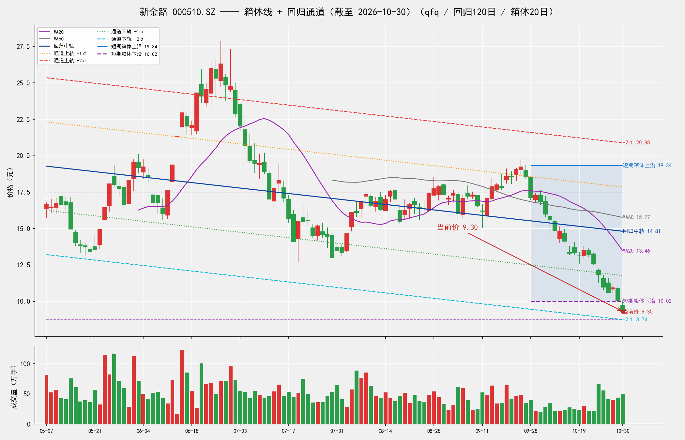

# DrX-新金路箱体回归模拟交易

**DrX Quantitative Research** · 2026年10月14日 · 每日 17:00 更新

> 30 万元虚拟资金，基于箱体回归分析的机械化模拟交易。全程记录信号、成交、资金曲线。

## 一、模拟规则（v2，A股 T+1 适配版）

**标的**：新金路 (000510.SZ)

**信号生成**（每日 17:00，基于截至当日收盘的 boxreg 分析 + trade_plan）：
- 动态仓位：上升通道最高 60% / 横向 50% / 下降 25% 或空仓（结合箱体质量）
- Box_Position ≤ 0.25 → **BUY**（限价=箱体下沿，分两步建仓）
- Box_Position ≥ 0.75 → **SELL**（三阶分批止盈 3:4:3）
- 收盘跌破锁定硬止损线 → **STOP_LOSS**（买入当日跌破：次日开盘无条件平仓；持仓可卖后跌破：当日收盘平仓，不拖到次日）

**T+1 分步建仓**：
- T 日：试探仓（目标仓位的 60%），限价=箱体下沿
- T+1 日：若 T 日收盘守住硬止损线，加确认仓（目标仓位的 40%）；若跌破，T+1 开盘止损试探仓

**成交判定**（穿透缓冲 0.01 元）：
- BUY：盘中 Low ≤ 限价 - 0.01 才成交；开盘跳空低开超 1.5% 则撤单
- SELL：盘中 High ≥ 限价 + 0.01 才成交

**硬止损**：锁定入场箱体下沿 - max(1.0×ATR, 20%箱体高度, 2.5%防毛刺)，持仓期间不随箱体重算漂移。每个交易日收盘都检查，与当日挂单如何处置无关（包括 T1 确认单被跳空取消的情形）。

**三阶止盈**（3:4:3）：
- TP1 30% @ max(箱体中轴, 回归中轨)，成交后止损上移至保本
- TP2 40% @ 箱体 0.80 分位
- TP3 30% @ min(箱体上沿, +2σ)

**费用**：佣金万三（最低 5 元）双边；印花税 0.1% 仅卖出。

## 二、启动分析（2026-10-14）

基于 2026-10-13 收盘数据的 boxreg 分析（已修复箱体破位自适应下移漏洞）：

| 指标 | 数值 |
|---|---|
| 收盘价 (10-13) | 14.82 |
| 箱体上沿 / 下沿 | 18.98 / 15.68 |
| 当前价位置 | **箱体下方（破位）** |
| 硬止损线 | 15.02 |
| 回归趋势 | 横向（β=+0.0058/日） |

**关键修正**：10-13 日最低价 14.01 跌破原箱体下沿。修复前代码会自动把箱体下沿下移至 14.01 并继续提示买入（死锁 bug）；修复后箱体锁定在 15.68–18.98，正确识别为**破位**，今日**不买入、空仓观望**。

**首日信号**：HOLD（破位观望）。等待价格重回箱体或形成新箱体后再行动。

## 最新 boxreg 图（每日更新）

截至 **2026-10-30 收盘**重算：当前价 9.30，MA20 13.46，MA60 15.77，回归中轨 14.81，箱体 10.02–19.34，+2σ 20.88 / -2σ 8.74。此图每日 17:00 用当日收盘数据重新计算（K线、MA20/MA60、回归通道、箱体全部更新），下方每日记录中另存当日图。

## 三、每日记录

### 2026-10-14（收盘）
- 今日行情：开 14.68 / 高 14.97 / 低 14.11 / **收 14.14**（-4.59%，昨日收 14.82）
- boxreg（截至今日收盘重算）：箱体 **15.05–19.76**（中轴 17.41），回归趋势横向（β=+0.0033/日）；Box位置 **-0.19**，收盘仍在箱体下沿下方 → 破位状态延续
- 昨日信号成交情况：前一日信号为 HOLD，无挂单，今日无成交
- 本次信号：**HOLD（破位观望）**——trade_plan 判定向下破位，当前无持仓故无止损动作，不开新仓
- 资金：**300,000.00 元（现金）**，持仓 0 股；累计收益 **0.00 元（0.00%）**

### 2026-10-15（收盘）
- 今日行情：开 13.37 / 高 13.79 / 低 13.21 / **收 13.30**（-5.94%，昨日收 14.14）
- boxreg（截至今日收盘重算）：箱体 **15.01–18.98**（中轴 17.00）；Box位置 **-0.43**，收盘仍在箱体下沿下方 → 破位状态延续（箱体下沿锁定有效，未随新低 13.21 自适应下移）
- 昨日信号成交情况：前一日信号为 HOLD（破位观望），无挂单，今日无成交
- 本次信号：**HOLD（破位观望）**——trade_plan 判定 STOP_LOSS 破位（当前价 13.30 跌破止损线 14.22），但当前无持仓故无止损动作，不开新仓
- 资金：**300,000.00 元（现金）**，持仓 0 股；累计收益 **0.00 元（0.00%）**

### 2026-10-16（收盘）
- 今日行情：开 13.68 / 高 14.06 / 低 13.24 / **收 13.32**（+0.15%，昨日收 13.30）
- boxreg（截至今日收盘重算）：箱体 **14.81–18.98**（中轴 16.90）；Box位置 **-0.36**，收盘仍在箱体下沿下方 → 破位状态延续（箱体下沿锁定有效，未随新低 13.24 自适应下移）
- 昨日信号成交情况：前一日信号为 HOLD（破位观望），无挂单，今日无成交
- 本次信号：**HOLD（破位观望）**——trade_plan 判定 STOP_LOSS 破位（当前价 13.32 跌破止损线 13.98），但当前无持仓故无止损动作，不开新仓
- 资金：**300,000.00 元（现金）**，持仓 0 股；累计收益 **0.00 元（0.00%）**

### 2026-10-19（收盘）
- 今日行情：开 13.13 / 高 13.34 / 低 12.56 / **收 13.12**（-1.50%，昨日收 13.32）
- boxreg（截至今日收盘重算）：箱体 **14.542–18.98**（中轴 16.76）；Box位置 **-0.32**，收盘仍在箱体下沿下方 → 破位状态延续
- 昨日信号成交情况：前一日信号为 HOLD（破位观望），无挂单，今日无成交
- 本次信号：**HOLD（破位观望）**——trade_plan 判定 STOP_LOSS 破位（当前价 13.12 跌破止损线 13.65），但当前无持仓故无止损动作，不开新仓
- 资金：**300,000.00 元（现金）**，持仓 0 股；累计收益 **0.00 元（0.00%）**

### 2026-10-20（收盘）
- 今日行情：开 13.12 / 高 13.80 / 低 13.03 / **收 13.49**（+2.82%，昨日收 13.12）
- boxreg（截至今日收盘重算）：箱体 **14.09–18.98**（中轴 16.54）；Box位置 **-0.12**，收盘仍在箱体下沿下方 → 破位状态延续
- 昨日信号成交情况：前一日信号为 HOLD（破位观望），无挂单，今日无成交
- 本次信号：**HOLD（破位观望）**——trade_plan 判定 STOP_LOSS 破位（当前价 13.49 触及止损线 13.11 一带），但当前无持仓故无止损动作，不开新仓
- 资金：**300,000.00 元（现金）**，持仓 0 股；累计收益 **0.00 元（0.00%）**

### 2026-10-21（收盘）
- 今日行情：开 13.52 / 高 13.66 / 低 13.08 / **收 13.19**（-2.22%，昨日收 13.49）
- boxreg（截至今日收盘重算）：箱体 **13.86–18.98**（中轴 16.42）；Box位置 **-0.13**，收盘仍在箱体下沿下方 → 破位状态延续
- 昨日信号成交情况：前一日信号为 HOLD（破位观望），无挂单，今日无成交
- 本次信号：**HOLD（破位观望）**——trade_plan 判定 STOP_LOSS 破位（向下破位状态延续），但当前无持仓故无止损动作，不开新仓
- 资金：**300,000.00 元（现金）**，持仓 0 股；累计收益 **0.00 元（0.00%）**

### 2026-10-22（收盘）
- 今日行情：开 13.25 / 高 13.33 / 低 12.50 / **收 12.56**（-4.78%，昨日收 13.19）
- boxreg（截至今日收盘重算）：箱体 **13.23–18.98**（中轴 16.11）；Box位置 **-0.12**，收盘仍在箱体下沿下方 → 破位状态延续
- 昨日信号成交情况：前一日信号为 HOLD（破位观望），无挂单，今日无成交
- 本次信号：**HOLD（破位观望）**——trade_plan 判定 STOP_LOSS（向下破位状态延续，价格未收回箱体下沿 13.23），但当前无持仓故无止损动作，不开新仓
- 资金：**300,000.00 元（现金）**，持仓 0 股；累计收益 **0.00 元（0.00%）**

### 2026-10-23（收盘）
- 今日行情：开 12.12 / 高 12.23 / 低 11.30 / **收 11.84**（-5.73%，昨日收 12.56）
- boxreg（截至今日收盘重算）：箱体 **13.184–18.98**（中轴 16.08）；Box位置 **-0.23**，收盘仍在箱体下沿下方 → 破位状态延续（箱体下沿锁定有效，未随新低 11.30 自适应下移）
- 昨日信号成交情况：前一日信号为 HOLD（破位观望），无挂单，今日无成交
- 本次信号：**HOLD（破位观望）**——trade_plan 判定 STOP_LOSS 破位（当前价 11.84 跌破止损线 12.25），但当前无持仓故无止损动作，不开新仓
- 资金：**300,000.00 元（现金）**，持仓 0 股；累计收益 **0.00 元（0.00%）**

### 2026-10-26（收盘）
- 今日行情：开 11.60 / 高 11.80 / 低 10.78 / **收 10.98**（-7.26%，昨日收 11.84）
- boxreg（截至今日收盘重算）：箱体 **13.07–18.98**（中轴 16.03）；Box位置 **-0.35**，收盘仍在箱体下沿下方 → 破位状态延续
- 昨日信号成交情况：前一日信号为 HOLD（破位观望），无挂单，今日无成交
- 本次信号：**HOLD（破位观望）**——trade_plan 判定 STOP_LOSS 破位（当前价 10.98 跌破止损线 12.11），但当前无持仓故无止损动作，不开新仓
- 资金：**300,000.00 元（现金）**，持仓 0 股；累计收益 **0.00 元（0.00%）**

### 2026-10-27（收盘）
- 今日行情：开 11.26 / 高 11.55 / 低 10.61 / **收 10.62**（-3.28%，昨日收 10.98）
- boxreg（截至今日收盘重算）：箱体 **12.94–18.58**（中轴 15.76）；Box位置 **-0.41**，收盘仍在箱体下沿下方 → 破位状态延续
- 昨日信号成交情况：前一日信号为 HOLD（破位观望），无挂单，今日无成交
- 本次信号：**HOLD（破位观望）**——trade_plan 判定 STOP_LOSS 破位（当前价 10.62 跌破止损线 11.98），但当前无持仓故无止损动作，不开新仓
- 资金：**300,000.00 元（现金）**，持仓 0 股；累计收益 **0.00 元（0.00%）**

### 2026-10-28（收盘）
- 今日行情：开 10.84 / 高 11.09 / 低 10.59 / **收 10.94**（+3.01%，昨日收 10.62）
- boxreg（截至今日收盘重算）：箱体 **10.61–19.76**（中轴 15.19）；Box位置 **0.04**，收盘位于箱体下沿附近
- 昨日信号成交情况：前一日信号为 HOLD（破位观望），无挂单，今日无成交
- 本次信号：**BUY（限价买入）**——Box位置 0.04 ≤0.25，次日挂 T0 试探买单 8400 股 @ 10.61（盘中最低 ≤10.60 判定成交；若成交，次日再挂 T1 确认买单 5600 股，硬止损 9.72）
- 资金：**300,000.00 元（现金）**，持仓 0 股；累计收益 **0.00 元（0.00%）**

### 2026-10-29（收盘）
- 今日行情：开 10.91 / 高 10.94 / 低 10.02 / **收 10.04**（-8.23%，昨日收 10.94）
- boxreg（截至今日收盘重算）：箱体 **10.59–19.76**（中轴 15.18），回归趋势下行（β=-0.0336/日）；Box位置 **-0.06**，收盘跌回箱体下沿下方 → 向下跌破箱体
- 昨日信号成交情况：昨日 BUY 信号的 T0 试探买单今日成交：盘中最低 10.02 ≤ 10.60，买入 **8400 股 @ 10.61**，锁定箱体 [10.61, 19.76]，硬止损 9.72
- 本次信号：**T1 确认买单待明日判定**——trade_plan 判定 STOP_LOSS（向下跌破箱体），但收盘 10.04 仍高于锁定硬止损 9.72，按脚本 T+1 规则明日先执行 T1 判定：挂 T1 确认买单 **5600 股 @ 10.61**（盘中最低 ≤10.60 判定成交；若明日判定日收盘已破硬止损则改为开盘止损，脚本以锁定硬止损 9.72 为准）
- 资金：权益 **295,185.26 元**（现金 210,849.26 元 + 持仓 8400 股 × 10.04），持仓 8400 股；累计收益 **-4,814.74 元（-1.60%）**

### 2026-10-30（收盘）
- 今日行情：开 9.74 / 高 10.04 / 低 9.22 / **收 9.30**（-7.37%，昨日收 10.04）
- boxreg（截至今日收盘重算）：箱体 **10.02–19.34**（中轴 14.68），回归趋势下行（β=-0.0375/日）；MA20 13.46 / MA60 15.77；Box位置 **-0.08**，收盘跌破箱体下沿 → 破位状态延续
- 昨日信号成交情况：昨日 T1 确认买单（5600 股 @ 10.61）今日**未成交、已取消**：开盘 9.74 跌破跳空保护线 10.45，触发跳空取消（昨日收盘 10.04 高于锁定硬止损 9.72，故未触发开盘止损）
- 本次信号与执行：**STOP_LOSS 已于当日收盘执行**——收盘 9.30 跌破锁定硬止损 9.72，当日收盘卖出全部 **8400 股 @ 9.30**（费用 101.56 元，已实现盈亏 **-11,132.29 元**），仓位清零，不存在拖到下周一的问题
- 资金：**288,867.71 元（全现金）**，持仓 0 股；累计收益 **-11,132.29 元（-3.71%）**
- 当日 boxreg 图（截至 10-30 收盘重算）：

- **更正说明（10-31）**：本条目原记录把止损拖到下周一开盘，系脚本 bug——10-30 当天 T1 确认单被跳空取消时，该分支没有补挂止盈/止损单，当日收盘的止损检查被整段跳过。按策略（持仓可卖后收盘跌破锁定硬止损，当日收盘离场），10-30 收盘即应卖出，现已按 9.30 补记成交（原权益 288,969.26 元为未扣卖出费用的持仓市值口径，更正后为全现金 288,867.71 元）。脚本已修复：T1 撤单后补挂三阶止盈单，且每日收盘增加通用止损兜底检查。此前发出的「周一开盘止损（A）/ 保持脚本（B）」两个选项随之作废。

---

*本模拟为量化研究记录，不构成投资建议。*
