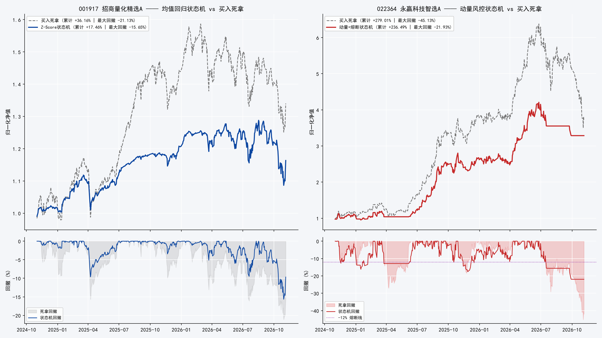
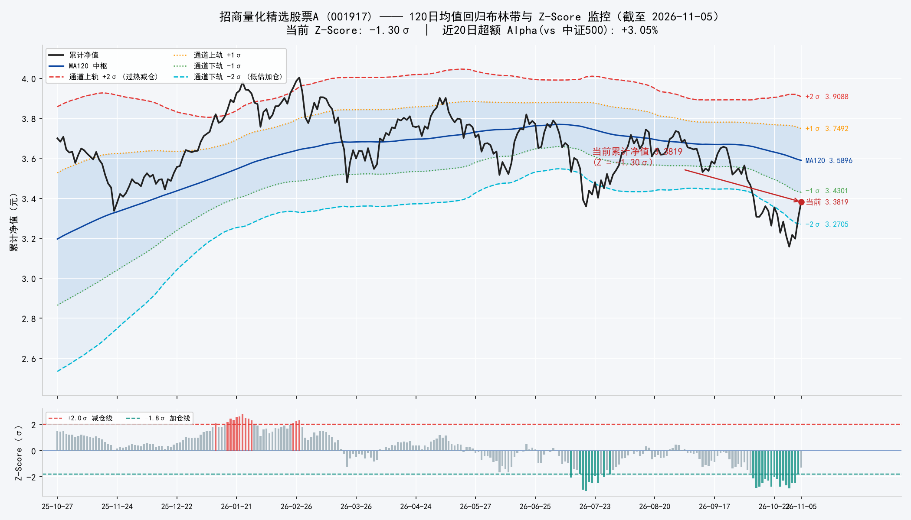
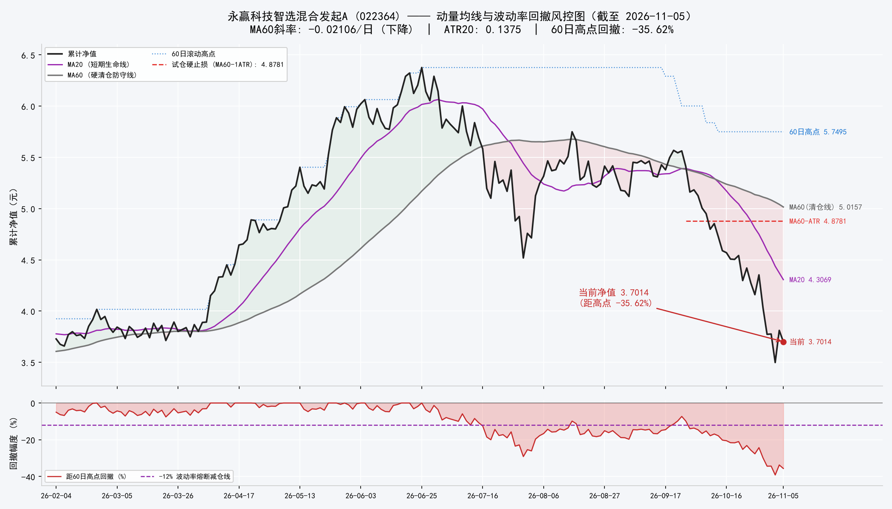

# Gu-双基金核心-卫星模拟仓：O-U 的静水流深，GBM 的乘风破浪

> 本项目是为 Gu 女士设计的双基金组合模拟仓：100 万元虚拟资金，70% 配置招商量化精选股票A（001917）、30% 配置永赢科技智选混合发起A（022364），两只基金运行两套完全隔离的状态机——前者是带因子失效保护的 Z-Score 均值回归引擎，后者是剥离抄底幻想的右侧动量与双层熔断引擎。自 2026-11-06 起每日盘后自动更新。本文为模拟交易记录与方法说明，不构成投资建议。

<!-- DAILY-CARD:START -->

## 今日操作卡（2026-11-06 盘前）

数据截至 2026-11-05 净值 ｜ 组合权益 1,000,000.00 元（累计 +0.00%）

**目前持仓**
- 招商量化精选股票A（001917）：空仓，现金 700,000.00 元
- 永赢科技智选混合发起A（022364）：空仓，现金 300,000.00 元

**今天怎么做**（今晚净值公布后按该净值执行）
- 招商量化精选股票A：仓位调至 60%（约 420,000.00 元）——启动建仓：NEUTRAL 区按规则建立 60% 标准底仓

**关键线（累计净值口径）**
- 001917：跌到 3.3024（-1.80σ）加仓一份；跌到 3.1907（-2.50σ）加至满仓；涨到 3.9088（+2.00σ）减仓锁利。当前 3.3819（Z = -1.30）
- 022364：MA60 清仓线 5.0157，当前 3.7014 已在其下 → 纪律空仓；等 MA60 斜率转正并回踩 MA20 企稳才右侧试仓

（本卡每日早间轮动更新，历史记录见下方每日记录）

<!-- DAILY-CARD:END -->

## 一、策略总览：来龙去脉、数学推导与实测回测

### 1. 来龙去脉：最大的业余，是用同一种直觉交易相反的数学分布

散户在场外基金上有两大经典死法。第一种：拿着一只前十大重仓高度集中、全部押注光模块与算力芯片的高弹性赛道基，在净值从高点回撤 15% 时安慰自己"跌多了总会反弹"，一路越跌越补、摊平成本，最后结结实实吃下腰斩级的深幅回撤——本项目的卫星标的 022364，历史最大回撤正是 -45.13%。第二种：拿着一只持仓分散在数百只中小盘股票上的多因子量化增强基金，在情绪亢奋、净值冲破 +2σ 上轨时满仓追进，结果在随后的均值回归里反复挨耳光。

这两种死法的根源是同一个：**把交易规则和资产的底层统计分布搞反了**——在趋势自我强化的资产里用均值回归抄底，在均值回归的资产里用动量逻辑追涨。交易系统的第一性原理，是让规则同构于资产的统计特性。

因此，本组合的两只基金从设计上就被放进两套拓扑完全不同的状态机：001917 赚的是"偏离后的均值收敛与因子 Alpha"，022364 赚的是"产业周期的右侧肥尾动量"。系统架构遵循算判分离：Python 在盘后完成全部浮点运算（净值清洗、指标、状态机裁决），输出的目标仓位在次日净值上机械执行；人的情绪不进入回路。这与本站新金路箱体回归模拟交易的工程信仰一脉相承：不要在交易时间做需要消耗多巴胺的决定。

### 2. 标的解构：两个相反的"数学物种"

| 维度 | 001917 招商量化精选股票A | 022364 永赢科技智选混合发起A |
| --- | --- | --- |
| 基金经理 | 王平（招商量化） | 任桀（永赢基金） |
| 底层内核 | 公募多因子量化选股，类中证500/1000 增强 | 高弹性科技主题：半导体、电子、AI 算力 |
| 持仓特征 | 极度分散：持股数百只，前十大集中度通常低于 20% | 极度集中：前十大重仓占比极高，单票逼近 10% 上限 |
| 核心驱动力 | 因子 Alpha 超额（跑赢中证500 的部分） | 行业 Beta（科技硬件景气周期） |
| 数学模型近似 | 去趋势后近似 Ornstein-Uhlenbeck 均值回归过程 | 带跳几何布朗运动（Jump-Diffusion），厚尾、趋势自我强化 |
| 近两年年化波动 | 20.45% | 46.04% |
| 组合角色 | 核心底仓（70%）：静水流深 | 卫星进攻仓（30%）：乘风破浪 |
| 状态机 | Z-Score 回归引擎 + Alpha 熔断器 | 右侧动量引擎 + 回撤/均线双层断路器 |

两只基金的极端性格都有实测注脚。022364 成立于 2024-10-30，2025 年全年净值涨幅超过 230%，累计净值在 2026-06-25 摸到历史高点 6.3763；随后科技周期退潮，至 2026-11-05 累计净值 3.7014，距历史高点已回撤 -41.95%，距 60 日高点回撤 -35.62%——它此刻正处在状态机为之设计的"深坑"里，本模拟仓对它的启动裁决是纪律空仓（见第二节）。001917 则相反：近一年净值回报 -7.32%，2026-11-05 累计净值 3.3819，位于自身 120 日中枢下方 -1.30σ 处，近 20 日相对中证500 的超额 Alpha 为 +3.05%——量化模型没有失灵，只是市场 Beta 在跌，这正是左侧体系眼中"便宜但不急于满仓"的位置。

### 3. 状态机一（001917）：从 O-U 过程推导 Z-Score，再给它装上因子熔断器

**均值回归的数学原型。** 均值回归过程的标准形式是 Ornstein-Uhlenbeck（O-U）过程：

$$dX\_t = \theta (\mu - X\_t) dt + \sigma dW\_t$$

其中 $\mu$ 是长期均衡水平，$\theta > 0$ 是回归速度（偏离越大、拉回的力越强），$\sigma$ 是瞬时波动，$W\_t$ 是标准布朗运动。用 Itô 公式解这个随机微分方程，可得 $X\_t$ 的条件分布为正态分布，且当 $t \to \infty$ 时收敛到平稳分布：

$$X\_{\infty} \sim N\left(\mu, \frac{\sigma^2}{2\theta}\right)$$

这条公式是整个状态机的数学底座：**只要过程是平稳 O-U，偏离量除以平稳标准差就是一个标准正态变量**，偏离的"罕见程度"可以直接读概率。半衰期 $\ln 2 / \theta$ 则告诉我们偏离收敛回中枢的时间尺度。

**从过程到指标。** 宽基量化基金的累计净值 $P\_t$ 本身带趋势（经济与盈利的长期漂移），不能直接套 O-U；但把趋势用慢速均线 MA120 剥离后，剩余偏离在经验上近似平稳。于是定义：

$$Z\_t = \frac{P\_t - \text{MA}\_{120}(P\_t)}{\sigma\_{120}(P\_t)}$$

其中 $\sigma\_{120}$ 是累计净值的 120 日滚动标准差。若偏离近似平稳正态，则 $Z \le -1.8$ 的概率约 3.59%、$Z \ge +2.0$ 的概率约 2.28%——都是尾部事件，值得用真金白银（哪怕是模拟的）回应；而 (-1.8, +2.0) 之间的日常噪声不值得交易。注意必须使用**累计净值**：单位净值在分红除息日会人为跳水，用单位净值算均线会在分红日产生假的"暴跌破位"信号。

**为什么 -2σ 不能无脑买：Alpha 熔断器。** 朴素均值回归有一个致命漏洞：它分不清"指数 Beta 下跌"与"量化 Alpha 崩溃"。若发生微盘流动性踩踏或风格因子反转，$Z$ 跌破 -2 不是因为便宜，而是选股引擎本身在失血——此时 O-U 的平稳性假设已经失效，$\mu$ 正在漂移，接飞刀就是接一个正在下移的中枢。因此在左侧加仓分支上串联相对强弱校验：

$$\text{Alpha}\_{20d} = R\_{\text{fund}, 20d} - R\_{\text{ZZ500}, 20d}$$

只有当 $\text{Alpha}\_{20d} \ge -1.00\%$（模型至多轻微跑输）时才允许加仓；若 $\text{Alpha}\_{20d} < -3.00\%$（显著跑输基准），判定因子失效，拒绝加仓。另设系统性熔断：中证500 单日跌幅 $\le -3.50\%$ 时，无论 Z 多低都冻结一切调整——流动性冲击日的价格不携带正常信息。2026-11-05 的实测读数恰好展示了这套校验的价值：Z = -1.30 尚未进入加仓区，Alpha\_{20d} = +3.05% 表明模型在下跌中反而跑赢基准 3.05 个百分点——可以放心地按计划持有底仓。

**001917 状态机（目标仓位，占本袖资金）**

| 状态 | 触发条件 | 目标仓位 |
| --- | --- | --- |
| SYSTEM_HALT | 中证500 单日跌幅 ≤ -3.50% | 冻结，维持不变 |
| STRONG_BUY | Z ≤ -2.50 且 Alpha\_{20d} ≥ -1.00% | 100% |
| BUY | Z ≤ -1.80 且 Alpha\_{20d} ≥ -1.00% | 每触发一次 +20%，上限 100% |
| FACTOR_FAILURE | Z ≤ -1.80 且 Alpha\_{20d} < -3.00% | 拒绝加仓，维持不变 |
| SELL | Z ≥ +2.00 | 每触发一次 -30%，下限 20% |
| REBASE | -0.50 ≤ Z ≤ +0.50 且仓位低于 60% | 恢复 60% |
| NEUTRAL | 其余情形（标准底仓 60%） | 维持不变 |

### 4. 状态机二（022364）：跳跃扩散、退化 ATR 与两道焊死的铁闸

**为什么这只基金禁止均值回归。** 赛道基金在周期下行段的表现更接近 Merton 跳跃扩散：

$$\frac{dP\_t}{P\_{t-}} = \mu dt + \sigma dW\_t + J dN\_t$$

连续扩散之外叠加泊松跳跃项 $J dN\_t$（业绩雷、订单砍单、出口管制都是跳跃源），收益分布厚尾且左偏。更关键的是产业周期存在正反馈：景气下行时龙头公司的盈利预期被连续下修，"跌多了"不但不蕴含反弹，反而预示下一轮下修。在这种分布里做均值回归，等于假设一个不存在的 $\mu$。唯一自洽的做法是右侧动量：只跟随已确立的趋势，并用断路器把左尾截断。

**场外 ATR 的退化定义。** 股票 ATR 用日内高低点构造真实波幅；场外基金每天只有一个收盘净值，没有 High/Low，真实波幅在数学上严格退化为日间净值变动的绝对值：

$$TR\_t = |P\_t - P\_{t-1}|, \quad \text{ATR}\_{20} = \frac{1}{20}\sum\_{i=0}^{19} TR\_{t-i}$$

当前读数 ATR\_{20} = 0.1375 元，约相当于净值的 3.71%——即这只基金"平常的一天"就要摆动近 4 个百分点。所有阈值都应该用 ATR 而非固定百分比来标定：-12% 的回撤熔断线约等于 3.2 个 ATR 的不利运动，已经显著超出日常噪声，属于制度性信号而非情绪波动。

**两道铁闸。** 第一层是回撤熔断：追踪 60 日滚动最高累计净值 $H\_{60}$，水下回撤

$$DD\_t = \frac{P\_t - H\_{60}}{H\_{60}}$$

一旦 $DD\_t \le -12.00\%$，或连续 3 个交易日单日跌幅超过 $1.5 \times \text{ATR}\_{20}$，无条件减仓一半。第二层是一票否决清仓线：以 MA60 为中期趋势生命线，其斜率由近 5 日最小二乘拟合

$$\beta\_{60} = \frac{\sum\_{k}(k - \bar{k})(\text{MA}\_{60,k} - \overline{\text{MA}}\_{60})}{\sum\_{k}(k - \bar{k})^2}$$

只要连续 2 日收于 MA60 下方，或 $\beta\_{60} < 0$ 且净值位于 MA60 下方，直接清仓归零。要求"连续 2 日"而不是跌破当天就砍，是在给场外基金的摩擦成本让路：持有不足 7 天赎回要付 1.50% 惩罚性费率，状态机的入场节奏（趋势确立后回踩 MA20 才试仓）使平均持仓周期自然拉长到 25 个交易日以上，天然避开惩罚线；而一旦两日确认加斜率向下同时成立，趋势反转的证据强度远超一日噪声，斩仓不再犹豫。试仓的硬止损价同步写死为 $\text{MA}\_{60} - 1 \times \text{ATR}\_{20}$。

**022364 状态机（目标仓位，占本袖资金）**

| 状态 | 触发条件 | 目标仓位 |
| --- | --- | --- |
| HARD_EXIT | 连续 2 日收于 MA60 下方，或 MA60 斜率 < 0 且净值在 MA60 下方 | 0% |
| RISK_CUT | 距 60 日高点回撤 ≤ -12.00%，或连续 3 日跌幅 > 1.5 × ATR\_{20} | 砍至 ≤ 50% |
| RUN | 净值 > MA20 且 MA20 ≥ MA60 | 100% |
| RE_ENTRY | MA60 斜率 > 0 且净值回踩 MA20（距离 ≤ 1 × ATR\_{20}） | 试探至 60% |
| WAIT | 其余情形 | 维持不变 |

### 5. 组合数学：70/30 是怎样算出来的

核心-卫星的比例不是拍脑袋。两只基金近两年日收益的实测统计量为：$\sigma\_{001917} = 20.45\%$，$\sigma\_{022364} = 46.04\%$，相关系数 $\rho = 0.61$。组合方差公式

$$\sigma\_p^2 = w\_1^2 \sigma\_1^2 + w\_2^2 \sigma\_2^2 + 2 w\_1 w\_2 \rho \sigma\_1 \sigma\_2$$

代入 $w\_1 = 0.70$、$w\_2 = 0.30$：三项分别为 0.0205、0.0191 与 0.0241，合计 0.0636，得 $\sigma\_p = 25.22\%$。两个值得玩味的结论：其一，即便卫星仓的波动是底仓的 2.25 倍，30% 的权重也只让组合波动从 20.45% 抬到 25.22%，远低于按权重线性加权的 27.93%——相关性不满格（0.61）白白送了约 2.71 个百分点的分散化红利；其二，卫星仓以 30% 的资金贡献了组合方差的近三分之二，它是组合风险的绝对主导者，因此对它施加全系统最严厉的断路器（-12% 减半、破 MA60 清仓），等价于直接给整个组合的最大回撤上保险。反过来，若把比例倒成 30/70，组合波动将升至约 37%，且回撤主导权完全交给赛道周期——那不是核心-卫星，那是单押。

两袖在执行层完全独立记账、互不调拨：卫星仓止盈或止损释放的资金先回到本袖现金池等待下一次右侧信号，底仓的加仓只使用本袖资金。这样 70/30 的出资结构在任何时点都可审计，也避免"用底仓的钱去补卫星的坑"这种最常见的纪律溃败。

### 6. 两年实测回测：纪律买的是回撤的形状，不是最高的收益

以下结果为 2026-11-06 在本机以真实历史净值（akshare 公开接口）运行材料所附回测引擎所得：窗口 2024-11-01 至 2026-11-05 共 487 个交易日，信号于 T 日收盘产生、按 T+1 日净值成交（无未来函数），单边摩擦成本 001917 取 0.10%、022364 取 0.15%。组合层按 70/30 对两袖净值加权。

| 策略 / 标的 | 累计收益 | 年化收益 | 最大回撤 | 年化波动 | 夏普比率 | 卡玛比率 |
| --- | --- | --- | --- | --- | --- | --- |
| 001917 买入死拿 | +36.16% | +16.60% | -21.13% | 20.45% | 0.71 | 0.79 |
| 001917 Z-Score 状态机 | +17.46% | +8.34% | -15.65% | 12.82% | 0.49 | 0.53 |
| 022364 买入死拿 | +279.01% | +94.06% | -45.13% | 46.05% | 2.00 | 2.08 |
| 022364 动量+熔断状态机 | +236.49% | +82.91% | -21.93% | 36.20% | 2.23 | 3.78 |
| 70/30 组合（死拿） | +109.02% | +44.32% | -34.61% | 29.86% | 1.42 | 1.28 |
| 70/30 组合（双状态机） | +83.17% | +35.14% | -18.40% | 18.84% | 1.76 | 1.91 |

这张表必须如实解读，它不全是好消息：

第一，**022364 的状态机完成了它的本职工作**。在 2025 年主升浪中它基本满仓跟随，在 2026 年周期退潮时先被 -12% 熔断减半、再被 MA60 一票否决清仓，把 -45.13% 的腰斩级回撤硬生生压缩到 -21.93%，夏普从 2.00 升至 2.23、卡玛从 2.08 升至 3.78。代价是让出约 42.52 个百分点的累计涨幅——这是断路器的保费，明码标价。

第二，**001917 的状态机在这两年里是净付费的**。窗口内中证500 中盘股整体处于上行趋势，均值回归引擎在 +2σ 处反复减仓、又长期只维持 60% 至 80% 仓位，累计收益 +17.46% 明显跑输死拿的 +36.16%，夏普也更低；它换来的只有波动从 20.45% 降到 12.82%、回撤从 -21.13% 收窄到 -15.65%。这正是均值回归策略的宿命剖面：震荡与下行市里它是盾，单边牛市里它是税。本组合接受这笔税，因为组合层面需要的是一个低波中枢，而不是第三个进攻引擎。

第三，**组合层面的合成结果支持 70/30 + 双状态机的设计**：最大回撤从 -34.61% 压到 -18.40%（近乎减半），年化波动下降 11.02 个百分点，夏普从 1.42 提升到 1.76，卡玛从 1.28 提升到 1.91。换句话说，这套系统不承诺赚得最多，它承诺的是：在最难熬的那种行情里，账户的坑只有别人的一半深，而坑的深度决定了大多数人能不能拿得住、等到下一轮周期。

### 7. 模拟仓执行细则

- **资金与分袖**：虚拟资金 1,000,000.00 元；001917 袖预算 700,000.00 元，022364 袖预算 300,000.00 元，两袖独立记账、不跨袖调拨。
- **信号与成交**：每日盘后（21:40）拉取最新公布净值计算指标与状态；T 日信号按 T+1 日**单位净值**成交（申赎口径），指标与状态判断使用**累计净值**。周末与节假日无新净值则不处理、不重复记账。
- **费率（模拟口径）**：申购费 0.15%；赎回费按 FIFO 逐笔持有天数分档：不足 7 天 1.50%，7 至 180 天 0.50%，超过 180 天免收。
- **每日更新**：每晚更新当前状态、最新图表与每日记录；每个交易日早间 08:20 在文首刷新"今日操作卡"（盘前版），晚间随净值更新为收盘版。操作卡每日轮动、不留历史，历史细节查每日记录。
- **数据接口**：基金净值与指数行情经 akshare 公开接口获取（指数走新浪源，东财 push2 接口对本机限流已弃用为主源）；全部代码与材料已归档，可复现。

## 二、当前状态（截至 2026-11-05 净值）

- 组合总权益 **1,000,000.00 元**（累计 +0.00%），初始资金 1,000,000.00 元。
- **001917 袖**：权益 700,000.00 元 ｜ 现金 700,000.00 元 ｜ 持仓 0.00 份（单位净值 3.3119）｜ 当前目标仓位 0% ｜ 状态 **NEUTRAL**：基准震荡区，维持仓位不动。Z-Score -1.30，近 20 日超额 Alpha +3.05%。
- **022364 袖**：权益 300,000.00 元 ｜ 现金 300,000.00 元 ｜ 持仓 0.00 份（单位净值 3.7014）｜ 当前目标仓位 0% ｜ 状态 **HARD_EXIT**：跌破 MA60 且趋势向下，一票否决清仓/空仓。距 60 日高点回撤 -35.62%，MA60 清仓线 5.0157。
- **启动挂单**：按 2026-11-05 信号，今晚（2026-11-06）净值将申购 001917 至 60% 标准底仓（约 420,000.00 元）；022364 处于 HARD_EXIT，30 万元维持现金空仓，等待 MA60 斜率转正后的右侧重入信号。

## 最新图表（2026-11-05）

## 三、每日记录

### 2026-11-06

- 项目启动：100 万元虚拟资金到账（账面），两袖预算 70/30 分置，全现金待机。
- 启动信号（截至 2026-11-05 净值）：001917 单位净值 3.3119（当日 +2.51%），Z-Score -1.30、Alpha\_{20d} +3.05%，状态 NEUTRAL ——按规则建立 60% 标准底仓，挂单于今晚净值执行申购（约 420,000.00 元）；022364 单位净值 3.7014（当日 -2.89%），累计净值 3.7014 远低于 MA60 清仓线 5.0157，MA60 斜率 -0.02106/日，距 60 日高点回撤 -35.62%，状态 HARD_EXIT——30 万元全额现金空仓观望。
- 两年回测复核已随首文发布（见第一节第 6 小节）：双状态机组合最大回撤 -18.40%，对比死拿组合 -34.61%。
