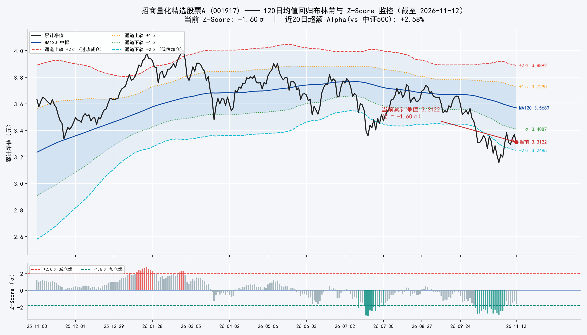
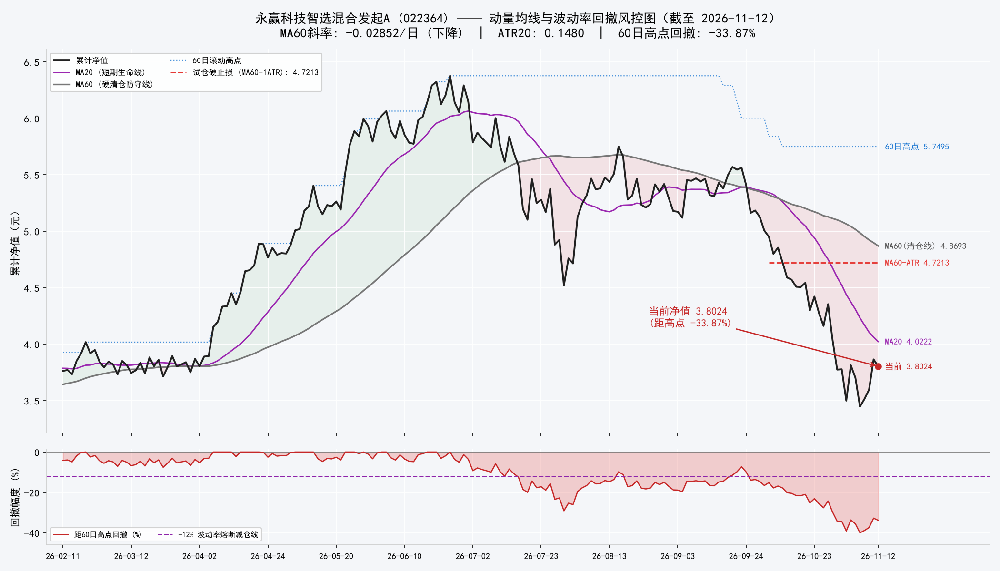
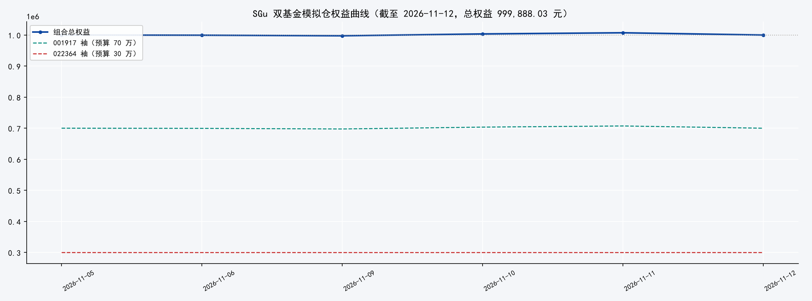

# SGu-双基金核心-卫星模拟仓：每日运行记录

> 本页记录一个双基金模拟仓的每日运行：虚拟资金 100 万元，招商量化精选股票A（001917）占 70%，永赢科技智选混合发起A（022364）占 30%，两袖独立记账，每日盘后更新。策略的设计依据、数学模型、完整规则与历史回测见理论篇：[《SGu-双基金核心-卫星组合：策略设计、数学模型与历史回测》](2026-11-06-SGu-双基金策略设计与回测.html)。本文为模拟交易记录，不构成投资建议。

本页每日更新两次：早间 08:20 刷新操作卡，盘后随基金净值更新持仓、成交与组合权益。

<!-- DAILY-CARD:START -->

## 今日操作卡（2026-11-12 收盘）

净值日期 2026-11-12 ｜ 组合权益 999,888.03 元（累计 -0.01%）

**今日结果**
- 今日无成交
- 招商量化精选股票A（001917）：单位净值 3.2422（-1.70%），持有 129,507.13 份，市值 419,888.03 元，状态 NEUTRAL
- 永赢科技智选混合发起A（022364）：单位净值 3.8024（-1.59%），空仓（现金 300,000.00 元），状态 HARD_EXIT

**明日安排**
- 无调仓挂单，维持现有仓位；022364 继续盯 MA60 清仓线 4.8693 与重入条件

（本卡每日晚间轮动更新，历史记录见下方每日记录）

<!-- DAILY-CARD:END -->

## 一、规则摘要

- 001917（占本袖资金）：按 Z-Score 档位调整仓位——Z ≤ -2.50 上调至 100%，Z ≤ -1.80 上调至 80%，Z ≥ +2.00 下调至 30%，Z 回到 -0.50 至 +0.50 区间时调整为 60%；近 20 日超额收益低于 -3.00% 时拒绝加仓；中证500 单日跌幅 ≤ -3.50% 时冻结调整，挂单在执行日触发该条件则顺延至下一净值日。
- 022364（占本袖资金）：跌破 MA60 且趋势向下时清仓至 0%；距 60 日高点回撤 ≤ -12.00% 或连续 3 日大跌时下调至 50% 以内；净值与均线多头排列时持有 100%；MA60 斜率转正且净值回踩 MA20 时上调至 60%。
- 成交与费用：T 日信号、T+1 日按单位净值成交；申购费 0.15%，赎回费按 FIFO 分档（不足 7 天 1.50%，7 至 180 天 0.50%，超过 180 天 0）。
- 规则的推导、参数依据与回测结果见理论篇，本页只记录执行结果。

## 二、当前状态（截至 2026-11-12 净值）

- 组合总权益 **999,888.03 元**（累计 -0.01%），初始资金 1,000,000.00 元。
- **001917 袖**：权益 699,888.03 元 ｜ 现金 280,000.00 元 ｜ 持仓 129,507.13 份（单位净值 3.2422）｜ 当前目标仓位 60% ｜ 状态 **NEUTRAL**：基准震荡区，维持仓位不动。Z-Score -1.60，近 20 日超额 Alpha +2.58%。
- **022364 袖**：权益 300,000.00 元 ｜ 现金 300,000.00 元 ｜ 持仓 0.00 份（单位净值 3.8024）｜ 当前目标仓位 0% ｜ 状态 **HARD_EXIT**：跌破 MA60 且趋势向下，一票否决清仓/空仓。距 60 日高点回撤 -33.87%，MA60 清仓线 4.8693。

## 最新图表（2026-11-12）

## 三、每日记录

### 2026-11-12

- 成交：无成交。
- 001917：单位净值 3.2422（-1.70%），Z-Score -1.60，状态 NEUTRAL（基准震荡区，维持仓位不动），目标仓位 60%。
- 022364：单位净值 3.8024（-1.59%），距 60 日高点回撤 -33.87%，状态 HARD_EXIT（跌破 MA60 且趋势向下，一票否决清仓/空仓），目标仓位 0%。
- 组合权益 999,888.03 元（累计 -0.01%）；001917 袖 699,888.03 元，022364 袖 300,000.00 元。

### 2026-11-11

- 成交：无成交。
- 001917：单位净值 3.2982（+0.88%），Z-Score -1.28，状态 NEUTRAL（基准震荡区，维持仓位不动），目标仓位 60%。
- 022364：单位净值 3.8637（+7.43%），距 60 日高点回撤 -32.80%，状态 HARD_EXIT（跌破 MA60 且趋势向下，一票否决清仓/空仓），目标仓位 0%。
- 组合权益 1,007,140.43 元（累计 +0.71%）；001917 袖 707,140.43 元，022364 袖 300,000.00 元。

### 2026-11-10

- 成交：无成交。
- 001917：单位净值 3.2695（+1.42%），Z-Score -1.48，状态 NEUTRAL（基准震荡区，维持仓位不动），目标仓位 60%。
- 022364：单位净值 3.5964（+2.34%），距 60 日高点回撤 -37.45%，状态 HARD_EXIT（跌破 MA60 且趋势向下，一票否决清仓/空仓），目标仓位 0%。
- 组合权益 1,003,423.57 元（累计 +0.34%）；001917 袖 703,423.57 元，022364 袖 300,000.00 元。

### 2026-11-09

- 成交：无成交。
- 001917：单位净值 3.2236（-0.45%），Z-Score -1.80，状态 NEUTRAL（基准震荡区，维持仓位不动），目标仓位 60%。
- 022364：单位净值 3.5140（+1.98%），距 60 日高点回撤 -38.88%，状态 HARD_EXIT（跌破 MA60 且趋势向下，一票否决清仓/空仓），目标仓位 0%。
- 组合权益 997,479.20 元（累计 -0.25%）；001917 袖 697,479.20 元，022364 袖 300,000.00 元。

### 2026-11-06

- 成交：招商量化精选股票A 申购 129,507.13 份 @ 单位净值 3.2382（金额 420,000.00 元，费用 630.00 元）。
- 001917：单位净值 3.2382（-2.23%），Z-Score -1.74，状态 NEUTRAL（基准震荡区，维持仓位不动），目标仓位 60%。
- 022364：单位净值 3.4458（-6.91%），距 60 日高点回撤 -40.07%，状态 HARD_EXIT（跌破 MA60 且趋势向下，一票否决清仓/空仓），目标仓位 0%。
- 组合权益 999,370.00 元（累计 -0.06%）；001917 袖 699,370.00 元，022364 袖 300,000.00 元。

### 2026-11-06

- 项目启动：100 万元虚拟资金到账（账面），两袖预算 70/30 分置，全现金待机。
- 启动信号（截至 2026-11-05 净值）：001917 单位净值 3.3119（当日 +2.51%），Z-Score -1.30、Alpha\_{20d} +3.05%，状态 NEUTRAL ——按规则建立 60% 标准底仓，挂单于今晚净值执行申购（约 420,000.00 元）；022364 单位净值 3.7014（当日 -2.89%），累计净值 3.7014 远低于 MA60 清仓线 5.0157，MA60 斜率 -0.02106/日，距 60 日高点回撤 -35.62%，状态 HARD_EXIT——30 万元全额现金空仓观望。
- 两年回测见理论篇（2026-11-06 修订：档位触发与 FIFO 分档费率口径）：双状态机组合最大回撤 -17.84%，买入持有组合 -34.61%。
