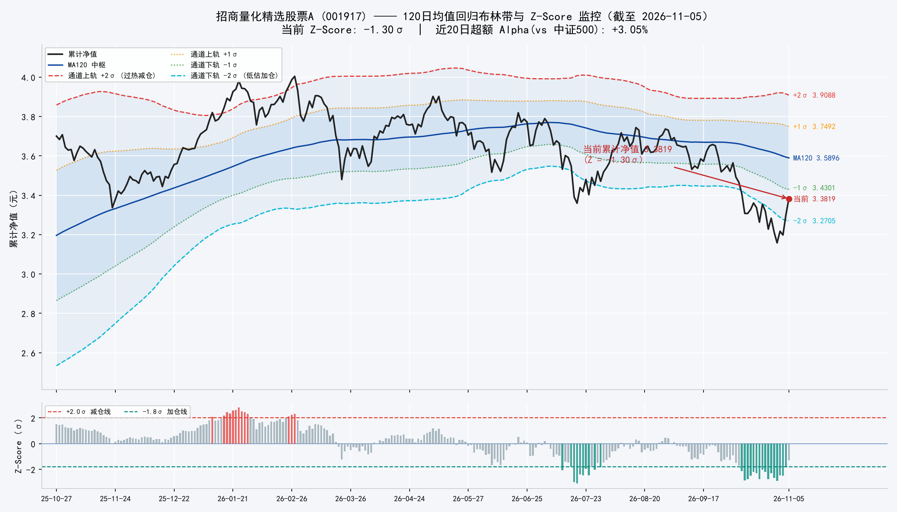
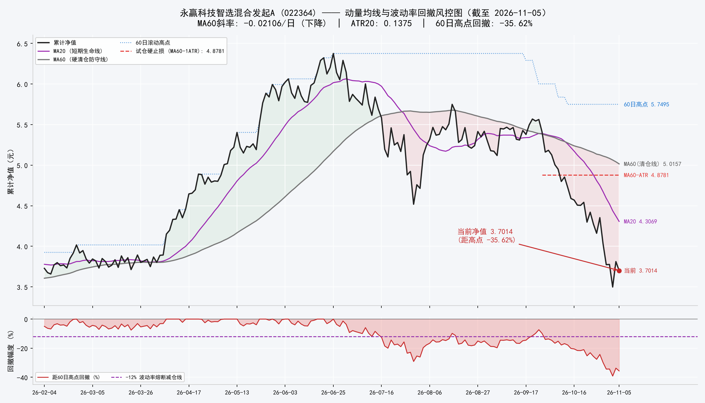
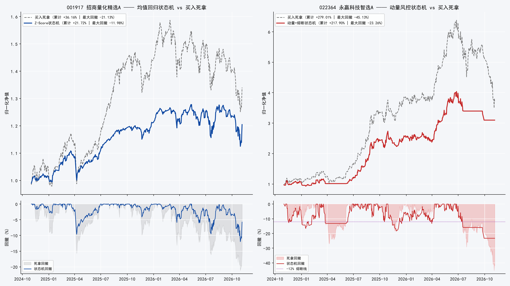

# SGu-双基金核心-卫星组合：策略设计、数学模型与历史回测

> 本文说明一个双基金模拟组合的设计依据、数学模型、交易规则与历史回测结果。组合由招商量化精选股票A（001917）与永赢科技智选混合发起A（022364）构成，虚拟资金 100 万元，按 70% 与 30% 分配，两只基金各用一套交易规则。模拟仓的每日运行记录（操作卡、持仓、成交、权益）见实操篇：[《SGu-双基金核心-卫星模拟仓：每日运行记录》](2026-11-06-SGu-双基金核心卫星模拟仓.html)。本文为研究记录，不构成投资建议。

## 一、组合构成与设计依据

两只基金的收益来源和波动特征不同，因此不使用同一套交易规则。

| 维度 | 001917 招商量化精选股票A | 022364 永赢科技智选混合发起A |
| --- | --- | --- |
| 基金经理 | 王平（招商量化） | 任桀（永赢基金） |
| 持仓结构 | 分散持有数百只股票，前十大重仓占比通常低于 20% | 集中持有科技股，前十大重仓占比高，单票接近 10% 上限 |
| 收益来源 | 多因子选股的超额收益（相对中证500） | 科技硬件行业的景气周期（半导体、电子、AI 算力） |
| 近两年年化波动 | 20.45% | 46.04% |
| 组合权重 | 70%（核心） | 30%（卫星） |
| 交易规则 | Z-Score 均值回归，带因子失效校验 | 右侧动量，带回撤与均线两道限制 |

设计依据是规则与收益分布匹配。均值回归规则假设价格偏离是暂时的、会回到中枢；动量规则假设趋势会持续一段时间。对前一只基金用动量、对后一只基金用均值回归，都与各自的分布特征不符，是这类组合常见的失效方式。

两只基金在数据上有以下实测特征。022364 成立于 2024-10-30，2025 年净值涨幅超过 230%，累计净值在 2026-06-25 达到历史高点 6.3763；此后科技板块回调，至 2026-11-05 累计净值 3.7014，距历史高点 -41.95%，距 60 日高点 -35.62%。001917 近一年净值回报 -7.32%；2026-11-05 累计净值 3.3819，位于其 120 日均线下方，Z-Score 为 -1.30，近 20 日相对中证500 的超额收益为 +3.05%，即下跌主要来自基准而非选股失效。两只基金的当前状态与模拟仓的启动处理见实操篇。

两袖独立记账，不跨袖调拨：每一袖的买卖只使用本袖资金，70/30 的出资结构在任何时点可核对。

## 二、001917：均值回归模型与 Z-Score 规则

**模型。** 均值回归过程的标准形式是 Ornstein-Uhlenbeck（O-U）过程：

$$dX\_t = \theta (\mu - X\_t) dt + \sigma dW\_t$$

其中 $\mu$ 为长期均衡水平，$\theta > 0$ 为回归速度，$\sigma$ 为瞬时波动，$W\_t$ 为标准布朗运动。该过程的平稳分布为正态分布：

$$X\_{\infty} \sim N\left(\mu, \frac{\sigma^2}{2\theta}\right)$$

即偏离量除以平稳标准差后服从标准正态分布，偏离程度可以直接换算为概率。偏离的半衰期为 $\ln 2 / \theta$。

**指标。** 累计净值本身带长期趋势，不能直接套用 O-U 过程；用 120 日均线代表中枢、120 日滚动标准差代表尺度，定义：

$$Z\_t = \frac{P\_t - \text{MA}\_{120}(P\_t)}{\sigma\_{120}(P\_t)}$$

其中 $P\_t$ 为累计净值。若偏离近似平稳正态，$Z \le -1.8$ 的概率约为 3.59%，$Z \ge +2.0$ 的概率约为 2.28%，属于低频事件；区间内的日常波动不触发交易。指标必须使用累计净值：单位净值在分红除息日会跳降，用它计算会产生虚假的破位信号。

**因子失效校验。** 净值下跌有两种来源：基准下跌，或选股模型本身失效（因子反转、流动性踩踏等）。后一种情形下中枢 $\mu$ 本身在下移，均值回归的前提不成立，不能按低估处理。为此定义近 20 日超额收益：

$$\text{Alpha}\_{20d} = R\_{\text{fund}, 20d} - R\_{\text{ZZ500}, 20d}$$

仅当 $\text{Alpha}\_{20d} \ge -1.00\%$ 时允许加仓；当 $\text{Alpha}\_{20d} < -3.00\%$ 时判定因子失效，拒绝加仓。另外，中证500 单日跌幅 $\le -3.50\%$ 时冻结全部调整（SYSTEM_HALT）：这类交易日的价格主要由流动性冲击驱动，不用于判断。

**状态机（档位触发）。** 目标仓位只取决于当前所处的档位，同一档位连续多日成立不重复累加：

| 状态 | 触发条件 | 目标仓位（占本袖资金） |
| --- | --- | --- |
| SYSTEM_HALT | 中证500 单日跌幅 ≤ -3.50% | 冻结，维持不变 |
| STRONG_BUY | $Z \le -2.50$ 且 $\text{Alpha}\_{20d} \ge -1.00\%$ | 上调至 100% |
| BUY | $Z \le -1.80$ 且 $\text{Alpha}\_{20d} \ge -1.00\%$ | 上调至 80%（已 ≥ 80% 则不变） |
| FACTOR_FAILURE | $Z \le -1.80$ 且 $\text{Alpha}\_{20d} < -3.00\%$ | 维持不变 |
| SELL | $Z \ge +2.00$ | 下调至 30% |
| REBASE | $-0.50 \le Z \le +0.50$ 且仓位 ≠ 60% | 调整为 60% |
| NEUTRAL | 其余情形 | 维持不变 |

## 三、022364：跳跃扩散模型与动量规则

**模型。** 赛道基金在周期下行段的净值路径更接近带跳的几何布朗运动（Merton 跳跃扩散）：

$$\frac{dP\_t}{P\_{t-}} = \mu dt + \sigma dW\_t + J dN\_t$$

在连续扩散之外叠加泊松跳跃项 $J dN\_t$，跳跃来源包括业绩低于预期、订单调整、出口管制等事件，收益分布厚尾。另外，产业周期存在正反馈：景气下行时盈利预期被连续下修，净值下跌不蕴含反弹。因此对该基金不使用均值回归规则，只在趋势确立后参与，并用两道限制截断左尾。

**波动尺度。** 场外基金每日只有一个净值，没有日内最高、最低价，真实波幅退化为相邻两日累计净值之差的绝对值：

$$TR\_t = |P\_t - P\_{t-1}|, \quad \text{ATR}\_{20} = \frac{1}{20}\sum\_{i=0}^{19} TR\_{t-i}$$

2026-11-05 的 $\text{ATR}\_{20}$ 为 0.1375 元，约为当日净值的 3.71%。下文的 -12.00% 回撤线约相当于 3.2 倍 $\text{ATR}\_{20}$，明显大于日常波动幅度。

**规则。** MA60 为中期趋势线，其斜率取近 5 日 MA60 的最小二乘拟合斜率。清仓条件满足其一即执行：连续 2 日收于 MA60 下方；或 MA60 斜率小于 0 且净值位于 MA60 下方。减仓条件满足其一即执行：距 60 日高点回撤 $\le -12.00\%$；或连续 3 个交易日单日跌幅超过 $1.5 \times \text{ATR}\_{20}$。试仓的止损价为 $\text{MA}\_{60} - 1 \times \text{ATR}\_{20}$，2026-11-05 的读数为 4.8781（由未舍入的 MA60 与 ATR20 计算）。

**状态机（目标仓位，占本袖资金）**

| 状态 | 触发条件 | 目标仓位 |
| --- | --- | --- |
| HARD_EXIT | 连续 2 日收于 MA60 下方，或 MA60 斜率 < 0 且净值在 MA60 下方 | 0% |
| RISK_CUT | 距 60 日高点回撤 ≤ -12.00%，或连续 3 日跌幅 > 1.5 × ATR\_{20} | 下调至 ≤ 50% |
| RUN | 净值 > MA20 且 MA20 ≥ MA60 | 100% |
| RE_ENTRY | MA60 斜率 > 0 且净值回踩 MA20（距离 ≤ 1 × ATR\_{20}） | 上调至 60% |
| WAIT | 其余情形 | 维持不变 |

## 四、组合比例的计算

以 2024-11-01 至 2026-11-05 共 487 个交易日的日收益计算：$\sigma\_{001917} = 20.45\%$，$\sigma\_{022364} = 46.04\%$，相关系数 $\rho = 0.61$。组合方差为：

$$\sigma\_p^2 = w\_1^2 \sigma\_1^2 + w\_2^2 \sigma\_2^2 + 2 w\_1 w\_2 \rho \sigma\_1 \sigma\_2$$

代入 $w\_1 = 0.70$、$w\_2 = 0.30$，三项分别为 0.0205、0.0191、0.0241，组合方差 0.0636，组合波动 $\sigma\_p = 25.22\%$。按权重线性加权的波动为 $0.70 \times 20.45\% + 0.30 \times 46.04\% = 28.13\%$，与 25.22% 的差额 2.91 个百分点来自 $\rho < 1$。

风险归因采用欧拉方差分解（交叉项由两只基金各分摊一半）：卫星仓以 30% 的资金权重贡献组合方差的 48.88%；若将协方差交叉项全部归于卫星仓，则占比为 67.78%。组合风险主要来自卫星仓，这是对它设置更严格规则（-12.00% 减仓、跌破 MA60 清仓）的依据。若比例改为 30/70，组合波动升至 36.29%，风险将由卫星仓主导，不再是核心-卫星结构。

以上数字由未舍入的日收益序列计算（验算脚本 code/verify_portfolio_math.py）；用文中四舍五入后的输入复算，结果可能相差约 0.02 个百分点。

注意静态权重与实际权重的差别：两袖独立运作、不做跨袖再平衡，涨幅大的袖实际权重会自然上升。因此下节回测中买入持有组合的实测波动（29.86%）高于此处按期初权重计算的 25.22%，原因是窗口内 022364 涨幅较大，其实际市值权重已高于 30%。

## 五、执行规则与费用

- **信号与成交**：T 日以累计净值计算指标并产生信号，T+1 日按单位净值成交。指标一律使用累计净值，成交一律使用单位净值。
- **执行日熔断**（2026-11-06 起）：001917 的挂单在执行日再校验一次 SYSTEM_HALT——若执行日中证500 单日跌幅 $\le -3.50\%$，挂单顺延至下一净值日执行，不撤销、不按当日净值成交。
- **费率**：申购费 0.15%；赎回费按 FIFO 逐笔持有天数分档：不足 7 天 1.50%，7 至 180 天 0.50%，超过 180 天 0。
- **数据与代码**：基金净值与指数行情经 akshare 公开接口获取（指数走新浪源）；全部代码与材料归档于项目目录，可复现。

## 六、历史回测（2024-11-01 至 2026-11-05）

方法：以 akshare 公开接口的真实历史净值回测，窗口 487 个交易日；规则与第二节、第三节完全相同，费率与第五节完全相同（申购 0.15%、赎回 FIFO 分档）；信号于 T 日产生、T+1 日生效。组合层按 70/30 对两袖净值序列加权，两袖不做再平衡。说明：本报告首版（2026-11-06 上午）中，001917 采用按次累加的仓位步进、回测费率采用统一单边费率（0.10%/0.15%），与实盘规则不一致；已于当日修订为档位触发与 FIFO 分档费率，下表为修订后的结果。

| 策略 / 标的 | 累计收益 | 年化收益 | 最大回撤 | 年化波动 | 夏普比率 | 卡玛比率 |
| --- | --- | --- | --- | --- | --- | --- |
| 001917 买入持有 | +36.16% | +16.60% | -21.13% | 20.45% | 0.71 | 0.79 |
| 001917 Z-Score 状态机 | +21.72% | +10.28% | -11.98% | 12.28% | 0.67 | 0.86 |
| 022364 买入持有 | +279.01% | +94.06% | -45.13% | 46.05% | 2.00 | 2.08 |
| 022364 动量+熔断状态机 | +217.90% | +77.81% | -23.26% | 36.27% | 2.09 | 3.34 |
| 70/30 组合（买入持有） | +109.02% | +44.32% | -34.61% | 29.86% | 1.42 | 1.28 |
| 70/30 组合（双状态机） | +80.57% | +34.19% | -17.84% | 18.77% | 1.71 | 1.92 |

对结果的说明：

第一，022364 状态机的回撤为 -23.26%，约为买入持有（-45.13%）的一半；代价是累计收益低 61.11 个百分点（+217.90% 对 +279.01%）。夏普比率由 2.00 升至 2.09，卡玛比率由 2.08 升至 3.34。

第二，001917 状态机的累计收益（+21.72%）低于买入持有（+36.16%），波动由 20.45% 降至 12.28%，回撤由 -21.13% 收窄至 -11.98%；夏普比率 0.67，略低于买入持有的 0.71，卡玛比率 0.86，高于买入持有的 0.79。该窗口内基准以上涨为主，均值回归规则在净值上行至 +2σ 时减仓、在大部分时间只维持 60% 至 80% 仓位，因此收益低于满仓持有。这是该规则在单边上涨窗口中的预期表现。

第三，组合层双状态机的最大回撤为 -17.84%，约为买入持有（-34.61%）的一半；年化波动由 29.86% 降至 18.77%；夏普比率由 1.42 升至 1.71，卡玛比率由 1.28 升至 1.92。

局限：回测窗口只有两年，且只包含一轮科技股周期；022364 的历史自其成立日（2024-10-30）起，没有更早的样本。回测按公布净值成交，未考虑申购限额、确认延迟与巨额赎回限制。结果对窗口选择敏感，不应外推为未来收益的估计。
