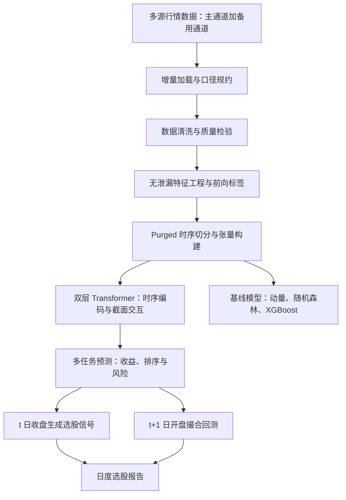

# DrX-Transformer 实操 · 第 0 篇：双层 Transformer 选股系统的架构与研究规范

本系列记录一个面向沪深 300 成分股的双层 Transformer 量化选股系统从设计、搭建到实证的完整实操过程。第 0 篇是开篇，讲系统的总体架构与研究规范；第一篇是开发日志，把真实样本试跑与校验结果放在最前面；第二篇是完整技术报告的公开版。本系列只对源代码与实现细节保密，方法逻辑、公式与全部验证结果完整公开，以求自洽。本系列为量化研究记录，不构成投资建议。

> 系列导览：第 0 篇（本篇）架构与研究规范 · [第一篇：真实样本试跑与全链路校验](2026-11-16-DrX-Transformer实操第一篇-真实样本试跑与全链路校验.html) · [第二篇：技术报告——系统设计与实证结果](2026-11-16-DrX-Transformer实操第二篇-技术报告.html) · [第三篇：Phase 2 技术报告——数据审计、工程修复与 Walk-Forward 验收](2026-11-16-DrX-Transformer实操第三篇-Phase2技术报告.html) · [第四篇：Phase 3 技术报告——数据源核查、诊断试点与付费数据准入](2026-11-16-DrX-Transformer实操第四篇-Phase3技术报告.html)

## 一、核心研究原则（不可妥协）

这套系统在设计时先立规矩、再写模型。四条原则在管线的各个环节强制执行：

1. **零未来信息泄漏。** 时刻 t 收盘后只能使用 t 日及以前已知的数据计算特征；横截面标准化只在单个交易日内部完成；时序统计量只能在训练窗口内拟合；预测标签（未来收益）只作监督目标，严禁混入特征矩阵。
2. **零幸存者偏差。** 每个交易日的有效股票池必须由当日（或截至当日最近一期）的历史成分股名单决定；若因数据权限退化为当前成分股快照，必须在日志、输出元数据与报告中显式标注幸存者偏差警告，不隐瞒。
3. **信号与成交时序严格对齐。** 信号在 t 日收盘后生成，只允许在 t+1 日开盘后执行交易，严禁以 t 日收盘价成交；回测须模拟涨跌停不可成交、停牌不可成交、剔除 ST 与 A 股 T+1 等真实制度约束。
4. **严禁伪造数据与实验结果。** 离线冒烟测试若使用合成数据，必须打上明确的模拟数据标记，与真实行情产出严格隔离，不得用于任何正式回测结论或性能汇报。

## 二、系统架构与数据流

系统按「数据 → 特征 → 模型 → 回测 → 报告」的链条组织，另有一条硬件基准线贯穿训练环节，用来在动手训练之前先量清手头算力的边界：

数据层支持多数据源路由：单一数据源在权限、限频或连接稳定性上出问题时自动降级到备用通道，各字段的实际来源逐项记录在数据质量报告里。特征与标签、模型、训练与回测各层之间只通过落盘的数据产物衔接，任何一层都可以单独复跑与核验。

## 三、特征与标签

### 3.1 五大类特征（共 35 项）

全部特征由截至 t 日收盘的历史行情计算，不含任何未来信息。输入窗口长度 L 标准配置为 60 个交易日，可配置为 120 日。

| 特征大类 | 数量 | 特征列表 | 经济含义 |
| --- | ---: | --- | --- |
| 价格与收益 | 11 | `ret_1d`、`ret_5d`、`ret_10d`、`ret_20d`、`ret_60d`、`overnight_ret`、`intraday_ret`、`high_low_range`、`close_to_ma5`、`close_to_ma20`、`close_to_ma60` | 多期限累计收益、隔夜跳空、日内走势、日内振幅与均线偏离度 |
| 动量 | 8 | `mom_5`、`mom_10`、`mom_20`、`mom_60`、`rsi_14`、`macd`、`macd_signal`、`macd_hist` | 多窗口趋势动量、相对强弱与 MACD 体系 |
| 波动率与风险 | 6 | `vol_5`、`vol_20`、`vol_60`、`atr_14`、`rolling_mdd_60`、`beta_csi300_60` | 多尺度实现波动率、平均真实波幅、滚动最大回撤、相对指数的滚动贝塔 |
| 成交量与流动性 | 5 | `volume_ratio_5_20`、`amount_ratio_5_20`、`turnover_rate`、`turnover_change_1d`、`amihud_illiquidity_20` | 量能与成交额的短期脉冲比率、换手水平及其变化、Amihud 非流动性 |
| 市场与相对强弱 | 5 | `csi300_ret_1d`、`csi300_mom_20`、`csi300_vol_20`、`stock_excess_ret_1d`、`industry_rel_strength_20` | 指数的收益、动量与波动环境，个股超额收益与相对强弱 |

其中隔夜收益为 $O\_{t} / C\_{t-1} - 1$，日内收益为 $C\_{t} / O\_{t} - 1$，振幅为 $(H\_{t} - L\_{t}) / C\_{t-1}$，Amihud 非流动性为 $|r\_{t}| / \text{amount}\_{t}$ 的滚动均值。

### 3.2 标准化：个股与市场环境分流

个股特征只在同一交易日 t 的有效成分股截面内部做 Z-score 标准化，并截断极端值：

$$z\_{i,t,f} = \operatorname{clip}\left(\frac{x\_{i,t,f} - \mu\_{t,f}}{\sigma\_{t,f} + 10^{-8}},\, -3.0,\, 3.0\right)$$

市场环境特征同日所有股票共享同一数值，若参与截面标准化会因当日截面方差为零而失真，因此采用固定先验尺度映射，保留其时序上的宏观状态信息：`csi300_ret_1d / 0.015`、`csi300_mom_20 / 0.05`、`(csi300_vol_20 - 0.012) / 0.006`。

### 3.3 标签

标签采用一致的复权价格口径。个股 i 在 t 日之后 k 日的收益定义为：

$$r\_{i,t,k} = \frac{P^{\text{adj}}\_{i,t+k}}{P^{\text{adj}}\_{i,t}} - 1$$

其中 k 取 5、10、20 个交易日；相对沪深 300 的超额收益为：

$$r^{\text{excess}}\_{i,t,k} = r\_{i,t,k} - r^{\text{CSI300}}\_{t,k}$$

另设未来持有期的实现波动率与下行风险作为辅助风险标签。所有未来标签严格隔离出特征矩阵，并由训练切分的隔离带保护。

## 四、双层 Transformer 与多目标学习

模型分两层，对应市场的两种结构。标准配置下，输入张量为 $X \in \mathbb{R}^{B \times N \times L \times F}$，其中 N 为当日有效成分股数、L 为窗口长度、F = 35 为特征数。

- **第一层（时序编码）**：对单只股票长度 L 的特征序列做自注意力编码——线性投影至 d_model = 128，叠加位置编码，经 3 层多头自注意力编码器（注意力头 4、前馈维度 256、dropout 0.1），再用注意力池化把整段隐状态聚合成每只股票在 t 日的状态表征 $h\_{i,t} \in \mathbb{R}^{128}$；
- **第二层（截面交互）**：把同一交易日全部股票的表征拼成截面序列 $H\_{t}$，引入行业嵌入与市场环境向量，经 2 层截面自注意力编码，配合掩码（key padding mask）处理可变股票数与停牌缺失，显式学习同日股票之间的资金跷跷板效应、动量拥挤度与相对强弱结构。

预测头输出三个量：预期收益、排序得分与风险估计，其中进入最终排序的是前两个预测头的结果——预期超额收益 $\hat{r}\_{i,t}$ 与预期未来风险 $\hat{\sigma}\_{i,t}$，综合得分按风险厌恶系数 λ = 0.25 做收益-风险权衡：

$$s\_{i,t} = \hat{r}\_{i,t} - 0.25 \cdot \hat{\sigma}\_{i,t}$$

训练目标为多任务加权损失（当前配置 α = 1.0、β = 1.0、γ = 0.5）：

$$\mathcal{L}\_{\text{total}} = \alpha \mathcal{L}\_{\text{return}} + \beta \mathcal{L}\_{\text{rank}} + \gamma \mathcal{L}\_{\text{risk}}$$

其中收益与风险两项为回归损失（均方误差，可切换为 Huber 鲁棒回归）；排序项为截面成对排序损失，先在当日截面内对得分做标准差归一化以消除量级漂移，再只在真实收益差异超过噪声阈值的股票对上计算：

$$\mathcal{L}\_{\text{rank}} = \operatorname{mean}\_{|r\_{i} - r\_{j}| > \tau\_{\text{pair}}}\left(\log\left(1 + \exp\left(-(\tilde{s}\_{i} - \tilde{s}\_{j}) \cdot \operatorname{sign}(r\_{i} - r\_{j})\right)\right)\right)$$

这一设计的目的很明确：选股最终用的是同一天股票之间的相对次序，而不是跨日可比的绝对数值；让损失函数直接对相对次序负责，并对收益与风险分别定价，模型才有可能学到「高收益预期必须同时报告高风险」这种对组合真正有用的结构。

## 五、训练验证与回测规范

- **时间切分**：训练 2015—2020 年、验证 2021—2022 年、测试 2023—2024 年，后续按滚动窗口（Walk-forward）更新；切分边界强制设置隔离带（purge 与 embargo 均不少于 5 个交易日），防止多日标签重叠造成泄漏。
- **交易成本**：买/卖佣金 0.025%（最低 5.00 元）、卖出印花税 0.05%、过户费 0.001%、双边滑点 5 个基点，全部可配置。
- **汇报指标**：扣费前后对比的年化收益、年化波动率、夏普比率、最大回撤、卡玛比率、胜率、平均持有期、换手率、总交易成本、超额收益与信息比率。

下一篇（第一篇）将给出这套系统在真实样本上的第一次端到端试跑：数据质检、硬件基准与样本外回测的全部校验结果。
