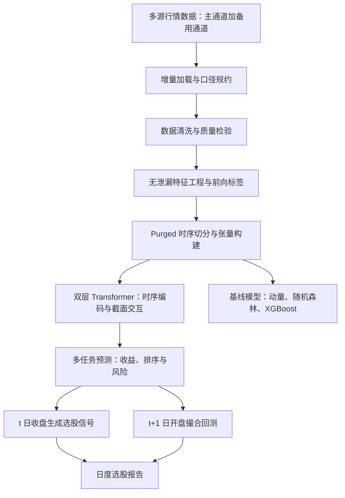

# DrX-Transformer 实操 · 第 0 篇：双层 Transformer 选股系统的架构与研究规范

本系列记录一个面向沪深 300 成分股的双层 Transformer 量化选股系统从设计、搭建到实证的完整实操过程。第 0 篇是开篇，讲系统的总体架构与研究规范；第一篇是开发日志，把真实样本试跑与校验结果放在最前面；第二篇是完整技术报告的公开版。出于知识产权保护，本系列博客只讲方法框架、研究约束与验证结果，省略实现层面的技术细节。本系列为量化研究记录，不构成投资建议。

> 系列导览：第 0 篇（本篇）架构与研究规范 · [第一篇：真实样本试跑与全链路校验](2026-11-16-DrX-Transformer实操第一篇-真实样本试跑与全链路校验.html) · [第二篇：技术报告——系统设计与实证结果](2026-11-16-DrX-Transformer实操第二篇-技术报告.html)

## 一、核心研究原则（不可妥协）

这套系统在设计时先立规矩、再写模型。四条原则在管线的各个环节强制执行：

1. **零未来信息泄漏。** 时刻 t 收盘后只能使用 t 日及以前已知的数据计算特征；横截面标准化只在单个交易日内部完成；时序统计量只能在训练窗口内拟合；预测标签（未来收益）只作监督目标，严禁混入特征矩阵。
2. **零幸存者偏差。** 每个交易日的有效股票池必须由当日（或截至当日最近一期）的历史成分股名单决定；若因数据权限退化为当前成分股快照，必须在日志、输出元数据与报告中显式标注幸存者偏差警告，不隐瞒。
3. **信号与成交时序严格对齐。** 信号在 t 日收盘后生成，只允许在 t+1 日开盘后执行交易，严禁以 t 日收盘价成交；回测须模拟涨跌停不可成交、停牌不可成交、剔除 ST 与 A 股 T+1 等真实制度约束。
4. **严禁伪造数据与实验结果。** 离线冒烟测试若使用合成数据，必须打上明确的模拟数据标记，与真实行情产出严格隔离，不得用于任何正式回测结论或性能汇报。

## 二、系统架构与数据流

系统按「数据 → 特征 → 模型 → 回测 → 报告」的链条组织，另有一条硬件基准线贯穿训练环节，用来在动手训练之前先量清手头算力的边界：

数据层支持多数据源路由：单一数据源在权限、限频或连接稳定性上出问题时自动降级到备用通道，各字段的实际来源逐项记录在数据质量报告里。特征与标签、模型、训练与回测各层之间只通过落盘的数据产物衔接，任何一层都可以单独复跑与核验。

## 三、特征与标签（框架）

特征分五大类，全部由截至 t 日收盘的历史行情计算，不含任何未来信息：

- **价格与收益**：多期限收益、隔夜与日内收益、振幅、价格相对多周期均线的位置；
- **动量**：多窗口动量与常用动量类技术指标；
- **波动率与风险**：多尺度波动率、真实波幅、滚动回撤、个股相对指数的滚动贝塔；
- **成交量与流动性**：量能与成交额的短期脉冲比率、换手率及其变化、非流动性度量；
- **市场与相对强弱**：指数自身的收益、动量与波动环境，个股相对指数的超额收益与相对强弱。

个股特征在每个交易日的截面内部做标准化；市场环境特征同日所有股票共享，采用固定尺度映射保留其时序信息，不参与截面标准化。

标签采用一致的复权价格口径。个股 i 在 t 日之后 k 日的收益定义为：

$$r\_{i,t,k} = \frac{P^{\text{adj}}\_{i,t+k}}{P^{\text{adj}}\_{i,t}} - 1$$

其中 k 取 5、10、20 个交易日；相对沪深 300 的超额收益为个股收益减去同期指数收益；另设未来一段时间的波动与下行风险作为辅助风险标签。

## 四、双层 Transformer 与多目标学习（框架）

模型分两层，对应市场的两种结构：

- **第一层（时序）**：对单只股票过去一段窗口的日频特征序列做自注意力编码，把每只股票在 t 日的状态压缩成一个表征向量；
- **第二层（截面）**：把同一交易日全部成分股的表征放在一起再做一层自注意力，让模型显式学习同日股票之间的相对强弱、资金跷跷板与联动关系，并支持股票数可变与停牌缺失的掩码处理。

预测头同时输出三类量：预期收益、截面排序得分与风险估计。训练目标由三部分加权组成：收益回归、截面成对排序与风险回归。其中排序部分只在真实收益差异足够大、超过噪声阈值的股票对上计算，避免模型去拟合标签噪声。最终选股得分在预期收益上按风险估计做折扣，收益与风险由模型自己定价。

## 五、训练验证与回测规范

- **时间切分**：训练 2015—2020 年、验证 2021—2022 年、测试 2023—2024 年，后续按滚动窗口（Walk-forward）更新；切分边界强制设置隔离带（purge 与 embargo），防止多日标签重叠造成泄漏。
- **交易成本**：按 A 股真实费率结构建模，含买卖佣金（有最低收费）、卖出印花税、过户费与双边滑点，全部可配置。
- **汇报指标**：扣费前后对比的年化收益、年化波动率、夏普比率、最大回撤、卡玛比率、胜率、平均持有期、换手率、总交易成本、超额收益与信息比率。

下一篇（第一篇）将给出这套系统在真实样本上的第一次端到端试跑：数据质检、硬件基准与样本外回测的全部校验结果。
