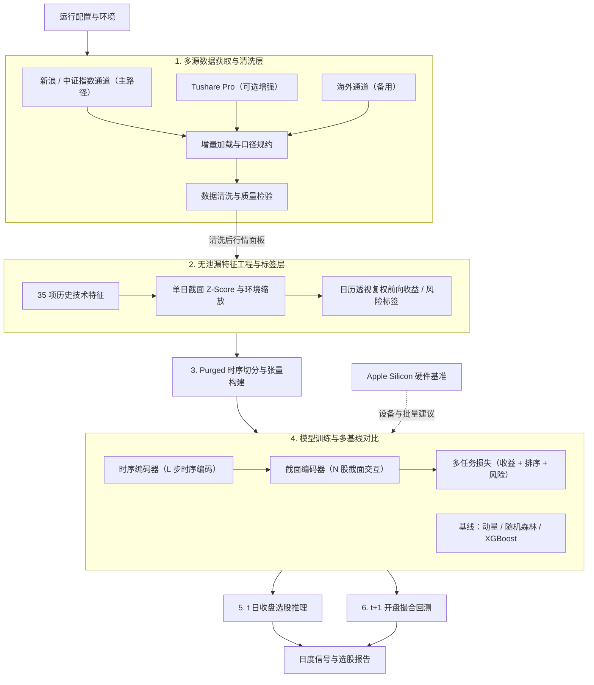

# DrX-Transformer 实操 · 第二篇：Phase 1 技术报告——系统设计与实证结果

本篇是双层 Transformer 沪深 300 选股系统的完整技术报告的公开版，系统整理研究约束、系统设计、多数据源工程、硬件基准与样本外实证结果。本系列只对源代码与实现细节保密，方法逻辑、公式与全部验证结果完整公开，以求自洽。本篇为量化研究记录，不构成投资建议。

> 系列导览：[开篇：架构与研究规范](2026-11-16-DrX-Transformer实操开篇-架构与研究规范.html) · [第一篇：真实样本试跑与全链路校验](2026-11-16-DrX-Transformer实操第一篇-真实样本试跑与全链路校验.html) · 第二篇（本篇）Phase 1 技术报告 · [第三篇：Phase 2 技术报告——数据审计、工程修复与 Walk-Forward 验收](2026-11-16-DrX-Transformer实操第三篇-Phase2技术报告.html) · [第四篇：Phase 3 技术报告——数据源核查、诊断试点与付费数据准入](2026-11-16-DrX-Transformer实操第四篇-Phase3技术报告.html)

## 先看结果（Highlights）

这一节只讲市场结果，不讲技术和数学。只关心「机器选股跑下来赚了多少、选了哪些股票」的读者，看这一节就够了；后面的章节是完整的技术报告。

**回测成绩（2024 年 1 月 24 日至 31 日，样本外模拟，交易费用已全部扣除）**

| 策略 | 期间收益 | 跑赢沪深 300 | 最大回撤 |
| --- | ---: | ---: | ---: |
| 本系统（双层 Transformer 选股） | +1.02% | +1.53% | -2.61% |
| 等权买入沪深 300 成分股 | +0.60% | +1.11% | -2.08% |
| 动量策略（买入近期强势股） | -0.61% | -0.09% | -2.96% |
| XGBoost（机器学习模型） | -3.18% | -2.66% | -5.38% |
| 随机森林（机器学习模型） | -7.02% | -6.50% | -9.34% |
| 同期沪深 300 指数 | -0.51% | — | — |

**选出的 10 只股票（2024 年 1 月 31 日收盘后给出，次日开盘买入）**

| 排名 | 股票 | 代码 |
| ---: | --- | --- |
| 1 | 爱尔眼科 | 300015.SZ |
| 2 | 药明康德 | 603259.SH |
| 3 | 比亚迪 | 002594.SZ |
| 4 | 长城汽车 | 601633.SH |
| 5 | 浦发银行 | 600000.SH |
| 6 | 兴业银行 | 601166.SH |
| 7 | 顺丰控股 | 002352.SZ |
| 8 | 平安银行 | 000001.SZ |
| 9 | 恒生电子 | 600570.SH |
| 10 | 工商银行 | 601398.SH |

名单一半是近期跌幅较大的成长龙头，一半是走势稳健的银行股，进攻与防守搭配出现，是模型自己选出来的。这次还有一个反直觉的现象：按「整体预测准不准」打分，动量策略和 XGBoost 更准，但模拟买卖下来反而亏钱；本系统赢在最靠前的 10 只选得更好。原因与数据在第五节有完整分析。

**先说清三件事（重要）**

- 这只是 2024 年 1 月一个月的短样本，样本外验证只有几天。结果只能证明整套流程真实跑通了，不能证明长期能赚钱；
- 回测用的成分股名单是现在的名单，不是 2024 年当时的名单，成绩会因此偏乐观（专业上称幸存者偏差），下一阶段会补齐历史名单重跑；
- 本篇是量化研究记录，不是投资建议，这份名单也不是荐股。

## 一、执行摘要

本系统是一个面向 A 股沪深 300 成分股横截面与时序联合排序的端到端量化选股研究系统，围绕「时序演化 + 截面竞争」的双重结构建模：先用时序 Transformer 编码每只股票自身的状态演化，再用截面 Transformer 建模同一交易日股票之间的相对关系，训练目标同时包含收益回归、尺度不变的截面成对排序与风险回归三项，并与防泄漏的时间切分（Purged 切分）、贴近 A 股真实制度的 t+1 开盘撮合回测集成在同一工程框架中。截至 MVP 验证阶段，已完成的里程碑如下：

1. **多数据源行情管线落地**：在主数据源部分接口受权限与频次限制、另一公开接口触发限流的真实环境下，重构为多源路由方案；2024 年 1 月共 22 个交易日的真实样本通过全部数据质量检查（面板 6,528 行 × 37 列、297 只有效成分股、核心字段零缺失）。
2. **Apple Silicon 硬件基准建成**：在 MacBook Air M4（32.00 GB 统一内存）上实测，MPS 相对 CPU 的前向推理加速约 3.11 倍、完整训练步加速约 3.50 倍；期间定位并解决了 macOS 上深度学习框架与树模型运行时同进程冲突的段错误问题。
3. **端到端实证闭环**：在防泄漏切分下完成双层 Transformer 与动量、随机森林、XGBoost、等权基准共五组策略的样本外对比，并产出完整的日度选股信号与候选深度分析。
4. **工程质量保障**：13 项自动化测试全部通过，覆盖数据转换与防泄漏边界、硬件探测与设备回退、模型与多任务损失、真实产出核验。

系统在代码层强制执行四项研究护栏（详见开篇）：零未来信息泄漏、零幸存者偏差（时点成分股，退化时显式警告）、信号与成交时序严格对齐（t 日收盘出信号、t+1 日开盘成交，涨跌停/停牌/ST 过滤、整手与 T+1 锁定）、严禁伪造数据（合成数据强制带模拟标记并与真实产出物理隔离）。

## 二、系统设计

### 2.1 分层与职责

系统分为六个子系统：多源数据获取与清洗、特征工程与标签、Purged 训练验证、两阶段模型与基线对比、t+1 回测与每日报告、Apple Silicon 硬件基准。其端到端数据与控制流如下图所示（图中节点已按本系列的公开口径去掉代码标识，只保留结构与数据流）：

各层职责如下：

| 分层 | 职责 |
| --- | --- |
| 配置与运行环境 | 全局参数集中管理：数据区间、特征清单、模型与基线超参数、多任务损失权重、交易成本；环境探测、随机种子与设备选择（CUDA → MPS → CPU） |
| 数据客户端 | 多数据源接入与代码格式互转：主数据源的接口探测与限频重试、稳定通道的成分/行情获取、备用通道回退；合成数据强制标记 |
| 成分股管理 | 沪深 300 时点成分股解析；快照回退时注入幸存者偏差警告 |
| 数据编排与清洗 | 增量存储、单位口径规约、复权因子严格历史对齐、面板质量报告生成 |
| 特征工程 | 35 项纯后视特征计算、截面标准化与市场环境缩放、前向收益/超额/风险标签构造 |
| 模型与损失 | 时序与截面两阶段 Transformer、多任务损失、动量与树模型基线（含 macOS 运行时防护） |
| 训练与切分 | 时序截面样本构建、Purged 切分隔离、多模型联合训练与评估 |
| 回测引擎 | t+1 开盘撮合、涨跌停/停牌/T+1 校验、费率与滑点计提、绩效指标汇总 |
| 推理与报告 | 每日打分与分层、信号表与选股报告生成 |
| 硬件基准套件 | 硬件信息采集、内存与显存监测、多规模压测与跨机对比报告 |

### 2.2 特征体系与标准化

特征共五大类 35 项（价格与收益 11、动量 8、波动率与风险 6、成交量与流动性 5、市场与相对强弱 5，完整清单见开篇第三节），全部基于截至 t 日收盘的复权价格、成交量/额、换手率及基准指数计算。标准化分两路：个股特征仅在同一交易日的有效成分股截面内部计算均值与标准差并截断至 [-3.0, 3.0]：

$$z\_{i,t,f} = \operatorname{clip}\left(\frac{x\_{i,t,f} - \mu\_{t,f}}{\sigma\_{t,f} + 10^{-8}},\, -3.0,\, 3.0\right)$$

市场环境特征同日所有股票共享同一指数数值，采用固定先验物理尺度映射保留宏观状态信息：`csi300_ret_1d / 0.015`、`csi300_mom_20 / 0.05`、`(csi300_vol_20 - 0.012) / 0.006`。

### 2.3 标签构造

先把面板透视至完整统一交易日历，再用一致复权收盘价构造前向标签（标准配置预测期为 5、10、20 日，MVP 短样本实证自适应取 3 日）：

$$r\_{i,t,k} = \frac{P^{\text{adj}}\_{i,t+k}}{P^{\text{adj}}\_{i,t}} - 1, \qquad r^{\text{excess}}\_{i,t,k} = r\_{i,t,k} - r^{\text{CSI300}}\_{t,k}$$

同时构造未来持有期实现波动率作为辅助风险标签。所有未来标签严格隔离出特征矩阵，并通过 Purged 切分边界保护。

### 2.4 两阶段 Transformer

输入为日度截面序列张量 $X \in \mathbb{R}^{B \times N \times L \times F}$（MVP 实证中 F = 35、L = 5；标准研究架构 L = 60 或 120）。

- **第一阶段（时序编码）**：将 B×N 只股票沿批次合并，线性投影至 d_model = 128，叠加位置编码后经 3 层多头自注意力编码器（注意力头 4、前馈维度 256、dropout 0.1），用注意力池化聚合长度 L 的隐状态序列，得到每只股票在 t 日的状态表征 $h\_{i,t} \in \mathbb{R}^{128}$；
- **第二阶段（截面交互）**：将第 t 日全部有效股票表征拼成截面序列 $H\_{t}$，经 2 层跨股票自注意力编码，配合掩码屏蔽非交易与缺失样本，显式建模同日成分股间的资金跷跷板效应、动量拥挤度与相对强弱结构；
- **双输出预测头**：输出预期超额收益 $\hat{r}\_{i,t}$ 与预期未来风险 $\hat{\sigma}\_{i,t}$，选股综合得分按风险厌恶系数 λ = 0.25 做收益-风险权衡：

$$s\_{i,t} = \hat{r}\_{i,t} - 0.25 \cdot \hat{\sigma}\_{i,t}$$

### 2.5 尺度不变多任务损失

总目标为三分支加权（完整模式权重 α = 1.0、β = 1.0、γ = 0.5）：

$$\mathcal{L}\_{\text{total}} = \alpha \mathcal{L}\_{\text{return}} + \beta \mathcal{L}\_{\text{rank}} + \gamma \mathcal{L}\_{\text{risk}}$$

收益与风险分支为回归损失（默认均方误差，可切换为 Huber 鲁棒回归）。排序分支为尺度不变截面成对排序损失：先在当日有效截面内对得分做标准差归一化（配合温度系数 1.0），消除不同训练步之间得分量级漂移导致的梯度消失或爆炸；再仅在真实标签差异大于噪声过滤阈值的股票对上计算：

$$\mathcal{L}\_{\text{rank}} = \operatorname{mean}\_{|r\_{i} - r\_{j}| > \tau\_{\text{pair}}}\left(\log\left(1 + \exp\left(-(\tilde{s}\_{i} - \tilde{s}\_{j}) \cdot \operatorname{sign}(r\_{i} - r\_{j})\right)\right)\right)$$

其中 $\tau\_{\text{pair}} = 0.002$。这一项的设计意图是让优化直接对「同一天股票之间的相对次序」负责，并把精力留给真正可分的股票对，而不是去拟合标签噪声。

## 三、多数据源工程与 Phase 1 数据质量验证

### 3.1 数据源探测与故障绕行

真实环境探测揭示了 A 股公开数据接口的三类典型瓶颈：其一，权限分级——历史成分权重、涨跌停与停牌名单、行业分类等接口在当前账号下被拒绝；其二，频次配额——交易日历、指数日线、股票基础、复权因子、每日指标等接口触发 1 次/小时上限，日线接口可用但全市场批量拉取间歇触发来源 IP 限制；其三，连接稳定性——东方财富通道在连续请求时触发限流与连接断开，无法稳定支撑 300 只成分股连续拉取。重构后的多源路由与各字段的实际来源如下：

| 数据域 | 实际来源 | 对齐规则与说明 |
| --- | --- | --- |
| 指数日线 | 新浪通道 | 沪深 300 指数日线，22 个交易日 |
| 交易日历 | 由指数日线派生 | 消除跨源节假日不一致 |
| 成分股与权重、股票基础 | 中证指数通道 | 300 只成分券及官方权重，快照日期 2026-10-30 |
| 个股日线 | 主数据源加新浪通道 | 原始行情 61,925 行（覆盖 5,340 只股票）；新浪数据按统一口径换算（成交量换算为手、成交额换算为千元） |
| 复权因子 | 新浪后复权因子 | 按日期键向后对齐：只取不晚于当日的最近历史记录，禁用未来日期 |
| 每日指标（换手率、流通市值等） | 由新浪行情与股本计算 | 换手率与流通市值按真实行情和股本口径推导 |
| 涨跌停价 | 按前收与板块规则推算 | 主板 ±10%、创业板/科创板（300/301/688）±20%、ST ±5% |
| 停牌 | 由缺失或零成交推断 | 成分股在有效交易日缺失或成交量为零即记停牌 |

### 3.2 Phase 1 验收结果

验收标记 `phase1_acceptance_passed = true`，数据来源标记为多源真实数据。清洗后面板 6,528 行 × 37 列，覆盖 2024-01-02 至 2024-01-31 全部 22 个交易日、297 只唯一成分股（当期 300 只成分中有 3 只在 2024 年 1 月尚未上市，日均有效池 296.73 只，侧面印证未出现伪造行情填充）。完整性指标：主键重复行 0、非正收盘价行 0、零成交量行 0、12 个必需核心字段缺失率 0.00%。已知缺口：上市日期缺失率 100.00%、行业字段为空；成分名单为当前快照回退，报告显式附加幸存者偏差警告。

## 四、Apple Silicon 硬件基准

### 4.1 测试环境与模型预设

测试机为 MacBook Air M4（机器型号 Mac16,13，10 核 CPU 即 4 个性能核加 6 个能效核，32.00 GB 统一内存），软件栈为 macOS 15.7.4、Python 3.11.18、PyTorch 2.15.0，MPS 后端已构建且可用、推荐最大显存 21.33 GB。基准条件：quick 模式，float32，seed = 42，预热 5 次、正式测量 20 次，标准输入维度 N = 300、L = 60、F = 40。模型设三档预设以便跨机公平对比：small（d_model = 64、时序 2 层、截面 1 层，107,522 参数）、base（d_model = 128、时序 3 层、截面 2 层，684,802 参数）、large（d_model = 256、时序 4 层、截面 2 层，留待大内存机型压测）。

### 4.2 实测结果（全量 10 项，无一内存溢出）

| 测试项 | 设备 | Batch | 规模 | 参数量 | 前向（毫秒） | 反向（毫秒） | 每步（毫秒） | 样本/秒 | 进程峰值内存（MB） | MPS 驱动占用（MB） |
| --- | --- | ---: | --- | ---: | ---: | ---: | ---: | ---: | ---: | ---: |
| cpu_forward_only | cpu | 4 | base | 684,802 | 273.84 | — | 273.84 | 14.61 | 686.09 | — |
| cpu_forward_backward | cpu | 4 | base | 684,802 | 742.37 | 608.10 | 1,353.86 | 2.96 | 3,226.14 | — |
| mps_forward_only | mps | 4 | base | 684,802 | 88.18 | — | 88.18 | 45.36 | 3,291.34 | 1,050.72 |
| mps_forward_backward | mps | 4 | base | 684,802 | 128.24 | 254.03 | 387.14 | 10.33 | 3,234.62 | 3,158.89 |
| bs_1 | mps | 1 | base | 684,802 | 28.10 | 58.44 | 91.28 | 10.96 | 3,083.88 | 1,177.83 |
| bs_2 | mps | 2 | base | 684,802 | 63.21 | 127.31 | 195.03 | 10.26 | 3,087.44 | 2,177.89 |
| bs_4 | mps | 4 | base | 684,802 | 124.47 | 245.82 | 373.54 | 10.71 | 3,090.36 | 3,159.89 |
| model_small | mps | 4 | small | 107,522 | 48.57 | 93.32 | 147.76 | 27.07 | 2,808.59 | 2,125.89 |
| model_base | mps | 4 | base | 684,802 | 124.92 | 246.72 | 375.52 | 10.65 | 2,812.56 | 3,173.89 |
| input_standard | mps | 4 | base | 684,802 | 123.49 | 246.29 | 372.78 | 10.73 | 2,732.45 | 3,159.89 |

三条规律。第一，MPS 加速显著：B = 4 标准负载下前向推理比 CPU 快 3.11 倍（273.84 对 88.18 毫秒），完整训练步快 3.50 倍（1,353.86 对 387.14 毫秒），快速基准范围内零内存溢出。第二，单日截面天然饱和算力：批量从 1 增至 4，吞吐维持在约 10.26 至 10.96 样本/秒的平台期、单步延迟近似线性上升——单个交易日已包含 300 只股票，第一层的有效批维度为 300 × 60、第二层是 300 个 token 的密集自注意力，批量为 1 时 GPU 并行度已被充分填满。第三，显存占用主要来自图形驱动的中间缓冲而非模型本身（base 在 B = 4 时模型实际分配仅约 21.72 MB，驱动占用却达 3,159.89 MB，随批量线性增长）；综合吞吐与占用，M4 上推荐批量 1 加 base 模型，在约 1.18 GB 驱动占用下取得最高训练吞吐。

### 4.3 排障实录：同进程运行时冲突段错误

首次把 MPS 深度学习模型与 XGBoost、随机森林基线串联在同一进程运行时，程序在 MPS 训练完成、进入树模型数据矩阵初始化阶段突发段错误（SIGSEGV，退出码 139）。根因是 macOS arm64 下两套 C++ 运行时各自加载并争用同一底层 OpenMP 线程池，在多线程设置下于进程上下文切换时触发线程竞争崩溃。工程修复分两点：在该平台下把树模型的并行线程数约束为单线程；对传入树模型的矩阵做内存连续化对齐。修复后多模型同进程联合评测稳定以退出码 0 完成。这一坑的教训是：跨框架混跑时，崩溃点往往不在崩溃的那一行，而在更早加载进进程的运行时之间。

### 4.4 跨机对比工作流

更大规模的 large 模型与算子级微基准留待完整模式与 Mac Studio M5 Max（64.00 GB）横向测评；基准工具已内置双机结果文件对比功能，可直接生成对比表与图。

## 五、端到端实证：样本外回测与 Top 10 分析

**研究范围坦诚说明**：本节全部数据来自 2024-01-02 至 2024-01-31 共 22 个交易日的 MVP 短样本实证，样本外评估仅 4 个有标签交易日与 6 个持仓回测日，且成分名单为当前快照回退（带幸存者偏差警告）。本节目的在于验证特征、Purged 训练、多模型对比与真实撮合回测的端到端工程正确性，不作为长期超额收益的定论依据。

### 5.1 切分与训练收敛

短样本启用自适应参数（回望窗口 5 日、预测期 3 日、隔离带 3 日）：训练集 2024-01-08 至 01-17（8 个交易日、表格化样本 2,371 行）；隔离区 01-18、01-19、01-22（3 个交易日，隔离 3 日前向标签重叠窗口）；样本外测试 01-23 至 01-31（7 个交易日，其中前 4 日具备完整 3 日真实标签用于 IC 评估，共 6 个持仓撮合日 01-24 至 01-31）。双层 Transformer 在 MPS 上训练 20 个轮次，总损失平滑单调收敛：epoch 1 为 0.94719，epoch 5 为 0.80301，epoch 10 为 0.72980，epoch 15 为 0.68308，epoch 20 为 0.66735。

### 5.2 五组策略对比

回测口径：初始资金 100.00 万元，每 3 个交易日调仓，等权选前 10 只，100 股整手，t 日收盘生成信号、t+1 日开盘价成交，买卖双向佣金 0.025%（最低 5.00 元）、仅卖出印花税 0.05%、过户费 0.001%、双边滑点 5 个基点，执行 T+1 卖出限制。样本外截面相关指标（4 个有标签交易日）如下：

| 策略 | IC | RankIC | ICIR | RankICIR | Top 10 评估超额 | 多空（Top10 - Bot10） |
| --- | ---: | ---: | ---: | ---: | ---: | ---: |
| 双层 Transformer | -0.0047 | -0.0012 | -0.12 | -0.04 | +1.14% | +0.04% |
| 等权沪深 300 | — | — | — | — | — | — |
| 动量基线 | +0.2620 | +0.3314 | 1.03 | 1.22 | -1.20% | +3.35% |
| XGBoost | +0.0705 | +0.0716 | 1.84 | 1.98 | -1.75% | +1.02% |
| 随机森林 | +0.0051 | +0.0204 | 0.17 | 0.64 | -4.26% | -0.07% |

样本外真实撮合回测绩效（6 个持仓日，同期沪深 300 为 -0.51%）如下：

| 策略 | 总收益 | 净超额 | 年化波动 | 夏普比率 | Sortino 比率 | 最大回撤 | 日胜率 | 交易笔数 | 总费用（元） |
| --- | ---: | ---: | ---: | ---: | ---: | ---: | ---: | ---: | ---: |
| 双层 Transformer | +1.02% | +1.53% | 20.51% | 2.16 | 2.70 | -2.61% | 50.00% | 24 | 973.90 |
| 等权沪深 300 | +0.60% | +1.11% | 16.57% | 1.57 | 2.26 | -2.08% | 50.00% | 214 | 1,076.00 |
| 动量基线 | -0.61% | -0.09% | 27.18% | -0.83 | -0.82 | -2.96% | 50.00% | 30 | 1,236.51 |
| XGBoost | -3.18% | -2.66% | 23.11% | -5.76 | -5.83 | -5.38% | 33.33% | 21 | 763.96 |
| 随机森林 | -7.02% | -6.50% | 37.66% | -7.91 | -7.74 | -9.34% | 16.67% | 25 | 966.98 |

一个极具启发性的现象是：**全截面线性 IC 与头部 Top 10 组合收益在风格剧烈切换期可能显著背离**。在 2024 年 1 月下旬先抑后剧烈分化的短窗口内，动量（IC +0.2620、RankIC +0.3314）与 XGBoost（IC +0.0705、ICIR 1.84）在全截面约 297 只股票的整体相关度上占优，但其头部前 10 组合在 3 日调仓与 t+1 滑点扣费后分别录得 -1.20% 与 -1.75% 的评估超额，真实净回测收于 -0.61% 与 -3.18%。相反，双层 Transformer 的全截面 4 日均值 IC 接近于零，却得益于截面排序头与风险惩罚头的协同约束，把收益集中在头部（Top 10 评估超额 +1.14%），扣费 973.90 元后录得 +1.02% 总收益、相对基准超额 +1.53%、夏普比率 2.16，优于等权基准的 +0.60%（且后者交易笔数高达 214 笔）。结论只能到这里为止：4 日样本统计量极小，这一背离是否稳定存在，必须在多年度完整历史回测中检验；但评价体系必须把全截面相关与头部组合收益分开报告，这一点从本节起就是本项目的固定做法。

### 5.3 2024-01-31 Top 10 候选深度分析

模型在 2024-01-31 收盘后对 297 只可交易成分股完成截面推理排序，前 10 名如下（前 9 名达到 97% 分位阈值为强候选，第 10 名为候选）：

| 排名 | 代码 | 名称 | 等级 | 综合得分 | 预测收益 | 预测风险 | 收盘价 | 当日涨跌 | 换手率 | RSI-14 | 5 日动量 | 指数权重 |
| ---: | --- | --- | --- | ---: | ---: | ---: | ---: | ---: | ---: | ---: | ---: | ---: |
| 1 | 300015.SZ | 爱尔眼科 | 强候选 | +0.12101 | +20.54% | 33.75% | 12.79 | -3.11% | 0.78% | 11.1 | -1.45 | 0.175% |
| 2 | 603259.SH | 药明康德 | 强候选 | +0.11956 | +20.11% | 32.60% | 54.20 | -4.66% | 2.56% | 13.3 | -1.51 | 1.548% |
| 3 | 002594.SZ | 比亚迪 | 强候选 | +0.11045 | +16.95% | 23.61% | 170.73 | -0.72% | 1.08% | 17.1 | -1.01 | 0.978% |
| 4 | 601633.SH | 长城汽车 | 强候选 | +0.10823 | +18.68% | 31.44% | 20.43 | -2.90% | 0.24% | 11.0 | -0.90 | 0.077% |
| 5 | 600000.SH | 浦发银行 | 强候选 | +0.08920 | +13.22% | 17.19% | 6.83 | 0.00% | 0.16% | 60.1 | +0.38 | 0.589% |
| 6 | 601166.SH | 兴业银行 | 强候选 | +0.08247 | +12.88% | 18.53% | 15.73 | +0.51% | 0.33% | 17.7 | +0.88 | 1.467% |
| 7 | 002352.SZ | 顺丰控股 | 强候选 | +0.07548 | +13.29% | 22.98% | 35.22 | +2.35% | 0.54% | 20.8 | -0.36 | 0.347% |
| 8 | 000001.SZ | 平安银行 | 强候选 | +0.07281 | +11.35% | 16.28% | 9.46 | -0.42% | 0.70% | 38.2 | +0.18 | 0.498% |
| 9 | 600570.SH | 恒生电子 | 强候选 | +0.07134 | +14.30% | 28.65% | 21.04 | -4.23% | 2.34% | 16.8 | -1.09 | 0.126% |
| 10 | 601398.SH | 工商银行 | 候选 | +0.06834 | +11.11% | 17.12% | 5.17 | +0.78% | 0.11% | 80.5 | +0.94 | 1.248% |

双预测头的输出呈现清晰的杠铃式双风格结构。一端是深度超跌高赔率弹性组（排名 1—4 与 9）：爱尔眼科（RSI-14 为 11.1、5 日动量 -1.45）、药明康德（13.3、-1.51）、比亚迪（17.1）、长城汽车（11.0）与恒生电子（16.8），模型给出 +14.30% 至 +20.54% 的预期收益，同时以 23.61% 至 33.75% 的预测风险明确标价其高波动。另一端是低波稳健动量银行组（排名 5、6、8、10）：浦发银行、兴业银行、平安银行与工商银行，预期收益温和（+11.11% 至 +13.22%），预测风险显著更低（16.28% 至 18.53%），且 5 日动量均为正（+0.18 至 +0.94），经得分公式的风险折扣后稳步进入前十。模型对高回报伴随高风险有清醒的定价，这正是设置风险预测头的目的。

## 六、质量保障、已知局限性与下一阶段路线图

### 6.1 自动化测试全量验证

全套 13 项单元与集成测试全部通过（0 跳过、0 失败）：硬件基准模块 5 项（命令行参数、真实系统硬件采集、内存监测、推荐配置与跨机对比、无 MPS 时的设备回退）；数据管道与质检 4 项（代码格式互转、时点成分与快照回退、防前视复权对齐与单位规约、真实产出与质检报告核验）；选股管线 4 项（未来价格扰动下特征不变的防前视检测、Purged 切分与撮合约束、真实选股产出存在性、Transformer 与多任务损失）。

### 6.2 已知局限性

1. **历史时间跨度受限**：真实面板仅 22 个交易日，只能支撑短窗口管线测试，尚不足以驱动规范要求的多年滚动验证与 60 / 120 日大窗口深层训练；
2. **历史时点成分权重缺口**：回测暂用当前成分快照（带幸存者偏差警告），接入正式历史成分变化记录是消除该偏差的最高优先级任务；
3. **行业与上市日元数据缺口**：上市日期缺失率 100.00%、行业字段为空，行业相对强弱特征暂时退化为相对全市场平均，新股剔除依赖价格窗口长度的自然过滤；
4. **双机硬件与算子微基准未闭环**：M5 Max 实机数据、算子级耗时剖面与 large 模型压测尚未运行。

### 6.3 下一阶段路线图

1. **全量历史回填与多年滚动回测**：扩展历史区间并补全历史成分与行业映射后，重跑数据检验与全量选股验证，进入大窗口训练与 Walk-forward 评估；
2. **多任务损失消融与结构调优**：逐项开关排序目标与风险目标（仅回归、无风险、无排序、完整四种模式），并对比 5、10、20 日多个预测期限，定量评估各部分对夏普比率与换手率的边际贡献；
3. **双机基准与精度配置**：在 Mac Studio M5 Max 上完成完整基准（含半精度测试）并与本次 M4 结果对比，确定全量多年训练的最优算力平台与精度配置。
