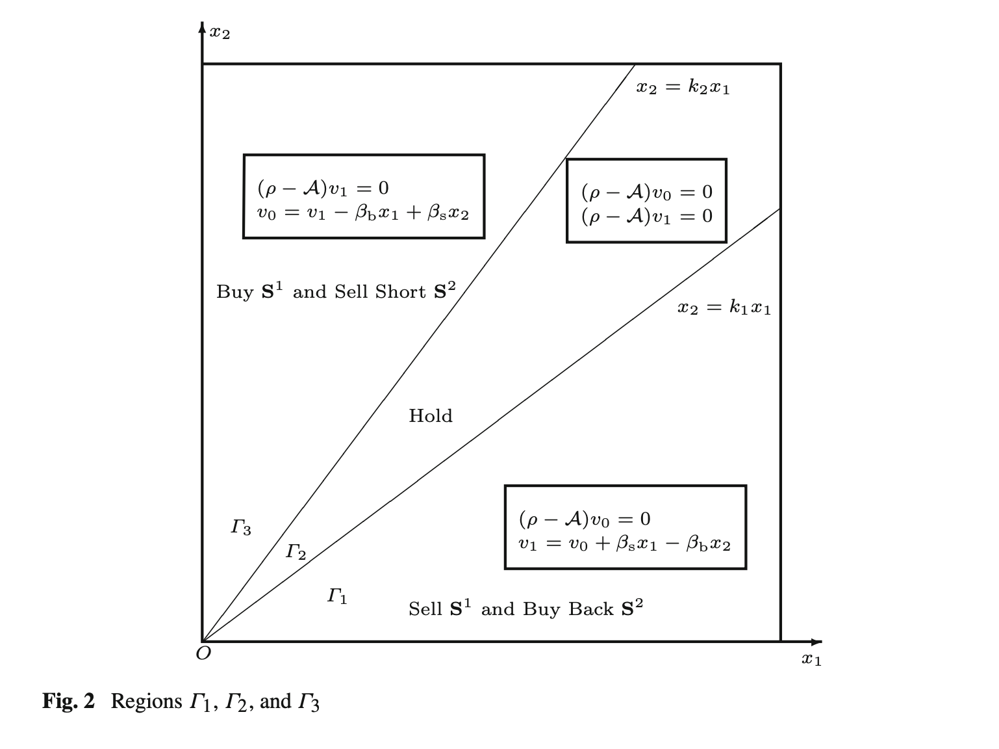
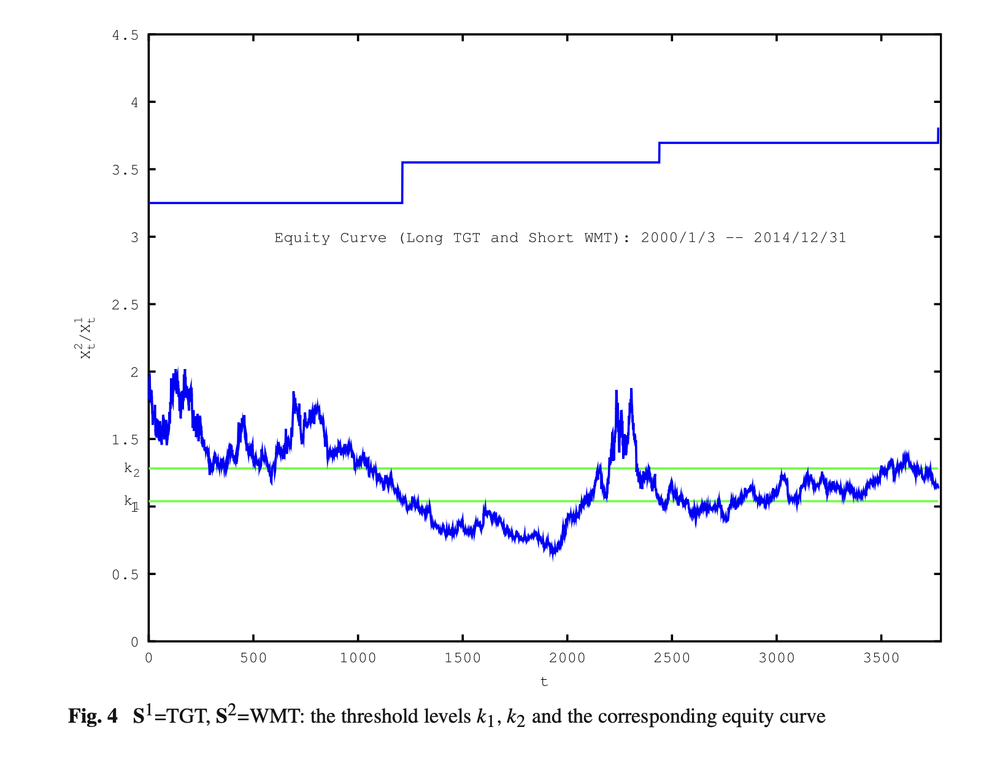

# 配对交易最优策略：GBM框架下的闭式解、回测与市场应用前景

配对交易是最经典的市场中性策略之一。这篇2017年发表于 JOTA 的论文（Tie, Zhang & Zhang）去掉了传统配对交易对"均值回归"的依赖，直接在几何布朗运动（GBM）下求出最优买卖阈值的闭式解，并用 Target / Walmart 做了15年样本外回测。本文解读论文的关键公式与实证结论，并探讨它在实际市场中的落地前景。

> 原文：Tie, Zhang & Zhang, "An Optimal Strategy for Pairs Trading Under Geometric Brownian Motions", *Journal of Optimization Theory and Applications* (2017).
> [论文原文 PDF 下载](Pairs_Trading.pdf)

## 一、论文讲了什么

配对交易的核心动作很简单：选两只股票，持续跟踪它们的相对强弱；当价差扩大到一定程度，**做空强势股、做多弱势股**，赌两者相对强弱反转。1980年代由摩根士丹利 Tartaglia 量化团队发扬光大，最大的优点是**市场中性**——涨跌市都能赚钱。

传统配对交易模型通常假设**价差服从均值回归**，这带来一个严重限制：可选的股票对基本只能是同行业高度相关的股票。这篇论文的突破在于：**去掉均值回归假设，允许股价服从一般的几何布朗运动**，用动态规划求最优交易时机，并得到了**闭式解**——最优策略由两条阈值线刻画，而非常数阈值。

## 二、关键公式：从 HJB 到两条阈值线

**1. 价格模型（GBM）**

两只股票价格 $X^1$、$X^2$ 服从：

$$
dX^1 = X^1(\mu_1dt + \sigma_{11}dW^1 + \sigma_{12}dW^2), \quad dX^2 = X^2(\mu_2dt + \sigma_{21}dW^1 + \sigma_{22}dW^2)
$$

$\mu$ 为收益率，$\sigma$ 为波动率，$W^1$、$W^2$ 为布朗运动（允许相关）。

**2. 目标：带交易成本的最优停时序列**

每次建仓/平仓收取固定比例成本 $K$（记 $\beta_b = 1+K$、$\beta_s = 1-K$）。目标是选择一列停时 $\tau_1 \le \tau_2 \le \cdots$（买入、卖出、买入、卖出……），最大化贴现收益。空仓时在 $\Gamma_3$ 开仓，持仓时在 $\Gamma_1$ 平仓，如此往复。

**3. HJB 方程与降维**

记价格比 $y = x_2/x_1$，价值函数可降为一元函数 $w(y)$，HJB 方程化为：

$$
\min\lbrace \rho w_0 - Lw_0,\ w_0 - w_1 + \beta_b - \beta_s y \rbrace = 0
$$

$$
\min\lbrace \rho w_1 - Lw_1,\ w_1 - w_0 - \beta_s + \beta_b y \rbrace = 0
$$

其中 $L$ 为二阶微分算子。Euler 方程 $(\rho-L)w = 0$ 的解形如 $y^\delta$，$\delta$ 满足二次方程，解得：

$$
\delta_{1,2} = \frac{1}{2}\left(1 + \frac{\mu_1-\mu_2}{\lambda}\right) \pm \frac{1}{2}\sqrt{\left(1 + \frac{\mu_1-\mu_2}{\lambda}\right)^2 + \frac{4(\rho-\mu_1)}{\lambda}}
$$

其中 $\lambda$ 为两股票相对波动率参数；当 $\rho > \mu_1, \mu_2$ 时有 $\delta_1 > 1 > 0 > \delta_2$。

**4. 阈值 $k_1$、$k_2$（闭式解）**

通过 smooth-fit 条件（价值函数及其一阶导数在阈值处连续），记 $r = k_2/k_1$，先解方程 $f(r) = 0$ 得唯一 $r_0$，再代入论文(12)式即得 $k_1$、$k_2$ 的闭式表达式。最终交易规则如下图：

- **$y \ge k_2$（$\Gamma_3$）：开仓**——买入组合（做多 $S^1$、做空 $S^2$）
- **$y \le k_1$（$\Gamma_1$）：平仓**——卖出 $S^1$、买回 $S^2$
- **$k_1 < y < k_2$（$\Gamma_2$）：持有不动**

*图：论文 Fig.2。$x_2 = k_1x_1$ 与 $x_2 = k_2x_1$ 两条射线把第一象限分成三个区域：左上 $\Gamma_3$ 开仓、中间 $\Gamma_2$ 持有、右下 $\Gamma_1$ 平仓。*

## 三、实证：TGT-WMT 十五年回测（关键结论）

**参数校准**：用 Target（TGT）、Walmart（WMT）1985–1999 年日收盘估计 $\mu_1 = 0.2059$、$\mu_2 = 0.2459$、$\sigma_{11} = 0.3112$、$\sigma_{22} = 0.2943$ 等；取 $K = 0.1\%$、$\rho = 0.5$，算得 **$k_1 = 1.039$、$k_2 = 1.282$**。

**回测设置**（2000/1/3–2014/12/31，15年）：初始资金 10 万美元；每次信号触发用 5 万美元做多 / 5 万美元做空（半仓对冲）；每笔配对交易佣金 5 美元。

**收益——论文报告的核心数字**：

| 方向 | 交易次数 | 期末资金 |
|---|---|---|
| 做多 TGT / 做空 WMT | 3 笔 | 155,914 美元 |
| 做多 WMT / 做空 TGT（反向） | 2 笔 | 132,340 美元 |
| **合计** | **5 笔** | **盈利 88,254 美元（+88.25%）** |

三个关键结论：

1. **15年只交易5次**，大部分时间资金以现金闲置——阈值策略天然低频，避免过度交易；闲置现金还可吃利息或做其他短线，这是论文特别强调的一点。
2. **正反两个方向交易时间不重叠**，不争用资金，可以同时跑，收益直接叠加。
3. **市场中性兑现**：2000–2014 横跨科网泡沫破裂与08金融危机，策略依然盈利，这正是配对交易的价值所在。

*图：论文 Fig.4。蓝色锯齿为价格比 $X^2/X^1$，绿线为 $k_1$、$k_2$ 阈值，上方蓝色阶梯为净值曲线——每次价格比上穿 $k_2$ 开仓、下穿 $k_1$ 平仓，净值阶梯式上行。*

**参数敏感性**（论文 Tables 1–5）：

- $\mu_1$ 越高 → 阈值下移，开仓机会更多；$\mu_2$ 越高 → 阈值上移
- 波动率越大 → 买卖区间都收缩（风险高，少动手）
- 两只股票相关性越高 → 开仓/平仓区间都扩大
- 交易成本 $K$ 越大 → 区间收缩；贴现率 $\rho$ 越大 → 更倾向于快进快出

## 四、结合市场的应用前景

### 1. A股落地的现实约束

- **融券端**："做空强势股"这条腿在A股较难直接复制——券源有限、融券成本高。可行的变体：用 **ETF 或股指期货**代替个股做空端，或只做多头配对（做多相对弱势、卖出相对强势的现有多头）。
- **T+1**：日内级别的反转信号无法当日平仓，策略更适合日线及以上周期。
- **涨跌停与停牌**：极端行情下价差可能跳过阈值，实盘执行要留缓冲，不能机械挂单。

### 2. 可以直接借用的框架

- **阈值即纪律**：$k_1/k_2$ 把"什么时候进出"变成了可计算的数。即使不用论文的精确公式，"价格比突破阈值才动手"这条纪律本身就有价值，能管住追涨杀跌的手。
- **参数滚动校准**：用滚动窗口估计 $\mu$、$\sigma$，定期重算 $k_1$、$k_2$，让阈值随市场状态自适应，而不是一套参数用到老。
- **组合扩展**：论文是一对股票；实际可扩展为一篮子配对——ETF vs 成分股、AH股、期货跨期、行业龙头 vs 行业ETF，逻辑相通。

### 3. 与现有量化实践的结合

- 均值回归类策略（OU过程、协整配对）要求先找到"会回归"的配对；GBM框架**不要求回归假设**，选股池大得多（跨行业也可以），代价是最优性更依赖参数估计质量。
- 适合作为**市场中性底仓**：在组合里配一小部分配对交易仓位，对冲 beta、赚相对价值的钱，尤其在震荡市里平滑净值。
- 高频化：把日线阈值逻辑搬到分钟线，框架不变，但要重新估计参数并计入冲击成本——$K$ 设小了阈值会过于激进。

### 4. 风险提示

- 模型假设两只股票永远按 GBM 走；**结构性变化**（如一家公司基本面质变、行业逻辑证伪）会让"相对价值"本身漂移，阈值失效。配对需要定期做基本面复核。
- 论文回测（TGT-WMT）是美股长牛样本；A股波动更大、制度不同，不可直接套用参数。
- 交易成本 $K$ 的设定对阈值很敏感，实盘前务必按真实费率（含滑点、融券成本、冲击成本）重算。

## 附：论文原文下载

[Pairs_Trading.pdf（2MB）](Pairs_Trading.pdf)
